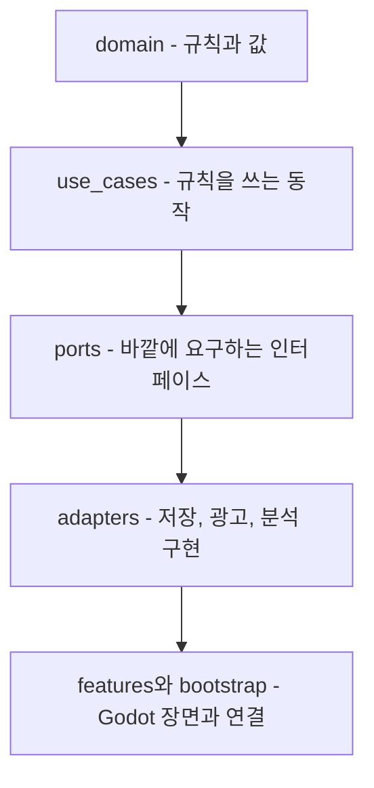

# 의존 규칙

제품 코드는 안쪽 레이어가 바깥 레이어를 모르는 구조를 따른다.

- `core`(domain, use_cases, ports)는 Godot 장면, 광고와 분석 SDK, 파일과 네트워크, 기기 API를 직접 참조하지 않는다.
- adapter는 port를 구현하고 `bootstrap`에서 주입한다.
- 장면과 스크립트(`features`)는 그리기, 입력, 수명 주기, 화면 흐름을 맡는다.
- 공통 묶음은 제품 코드를 참조하지 않는다.
