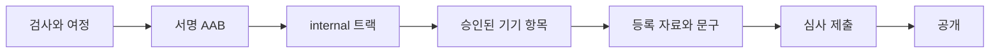

# 출시

Android 빌드와 Google Play 배포 절차를 둔다.

- [Android 빌드](android-build.md): 로컬과 CI에서 서명 AAB를 만드는 방법
- [workflow](ci-cd-workflows.md): 저장소의 GitHub Actions와 필요한 설정
- [체크리스트](release-checklist.md): 출시 전에 확인할 항목

승인된 끝 지점은 Google Play 공개 출시다(결정 로그 DEC-014). 순서와 정지 조건은 [첫 출시 설계](../design/2026-11-21-four-alike-launch/design.md)의 "적용·운영·되돌리기"와 "승인·추적" 절을 따른다. 각 단계는 실제로 실행한 근거가 있을 때만 다음으로 넘어간다.
