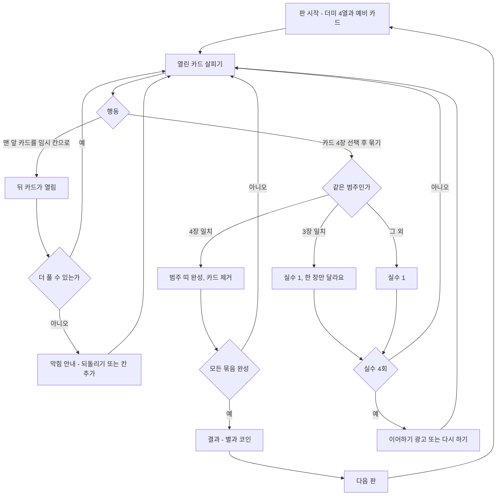
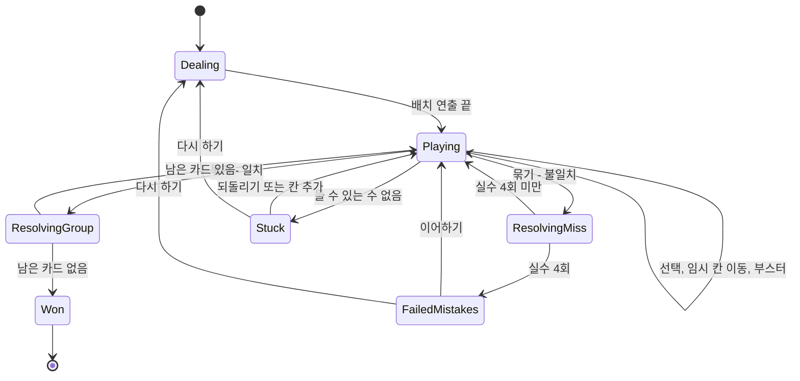

# 게임 디자인 문서

- 문서 상태: approved
- 승인 근거: 사용자 질문 응답 2026-11-21 (DEC-001~004, DEC-013~016)
- Source of truth: 규칙, 상태 머신, 진행, 저장과 리셋, 인수 시나리오
- 제품: Four Alike / 끼리끼리 (작업 ID `cluster-solitaire`)
- 작성일: 2026-11-21
- 근거: 사내 기획 저장소의 최초 기획서(2026-11-20, 비공개), 사용자 결정([결정 로그](decision-log.md)), 규칙 프로토타입 측정([05](05-economy-content-liveops.md) 시뮬레이션 증거)

이 문서는 규칙, 진행, 저장을 구현자가 추측 없이 옮길 수 있는 수준으로 정한다. 수치 가운데 플레이 데이터로 다시 맞출 값은 "가설"로 표시한다.

## 경험 타임라인

| 시점 | 플레이어가 겪는 일 | 설계 장치 |
|---|---|---|
| 첫 10초 | 열린 카드 8장 중 과일 4장이 한눈에 보인다. 4장을 누르고 묶으면 카드가 날아가 범주 이름 띠가 된다 | 튜토리얼 1단계. 광고와 팝업 없음 |
| 첫 3분 | 맨 앞 카드를 임시 칸으로 빼면 뒤집힌 카드가 열린다는 것을 배우고, 스스로 한 판을 끝낸다 | 튜토리얼 2~3단계, 스테이지 1~2(쉬움) |
| 첫 30분 | 임시 칸 2개가 모자라 막히는 순간을 처음 겪는다. 되돌리기나 3번째 칸으로 빠져나온다. 일일 도전과 도감이 열린다 | 스테이지 6부터 보통 난도, 막힘 안내, 부스터 3종 |
| 7일 | 매일 같은 일일 도전 한 판을 풀고 연속 기록을 잇는다. 도감의 범주가 차고 카드 뒷면을 바꾼다 | 일일 도전, 출석, 도감 보상, 코인 상점 |

## 코어 루프

한 판은 2~4분을 목표로 한다(가설, 출시 뒤 `level_end`의 경과 시간으로 확인).

## 규칙과 상태 머신

### 판 구성

카드는 범주마다 4장이다. 범주 이름은 완성 전까지 보이지 않는다. 판은 더미, 예비 카드, 임시 칸으로 이뤄진다.

| 구역 | 내용 |
|---|---|
| 더미 | 4열. 각 열은 맨 앞 1장만 열려 있고 나머지는 뒤집혀 있다. 맨 앞 카드가 나가면 바로 뒤 카드가 열린다 |
| 예비 카드 | 처음부터 열려 있는 카드. 선택만 할 수 있고 옮길 수 없다 |
| 임시 칸 | 기본 2칸, 판마다 1칸을 더 열 수 있다(최대 3칸). 더미의 맨 앞 카드만 넣을 수 있고, 넣은 카드는 묶음으로만 나간다 |

배치는 열별 장수와 예비 카드 수로 정한다.

| 배치 ID | 범주 수 | 열별 장수 | 예비 | 처음 열린 카드 | 용도 |
|---|---|---|---|---|---|
| `intro` | 3 | 2, 2, 2, 2 | 4 | 8 / 12 | 튜토리얼 |
| `open` | 4 | 2, 2, 2, 2 | 8 | 12 / 16 | 쉬움 |
| `step` | 4 | 3, 3, 2, 2 | 6 | 10 / 16 | 보통 |
| `classic` | 4 | 3, 3, 3, 3 | 4 | 8 / 16 | 표준(기획서 규격) |
| `deep` | 4 | 4, 3, 3, 2 | 4 | 8 / 16 | 어려움 |

범주 5개 판(20장)은 2칸으로 풀리는 무작위 배치가 10.7%뿐이고 화면 높이도 모자라 첫 출시에서 뺀다.

### 상수

| 이름 | 값 | 비고 |
|---|---|---|
| `GROUP_SIZE` | 4 | |
| `MISTAKE_LIMIT` | 4 | 4번째 실수에서 실패 |
| `HOLD_SLOTS_BASE` / `HOLD_SLOTS_MAX` | 2 / 3 | 3번째 칸은 그 판에만 유효 |
| `CONTINUE_RESTORE` | 2 | 이어하기는 실수 2회를 지운다. 판당 1회. 광고로 받고, 광고를 쓸 수 없을 때는 코인 150으로 산다(DEC-022) |
| `UNDO_SCOPE` | 마지막 임시 칸 이동 1회 | 묶음이 완성되면 되돌릴 기록을 비운다 |

### 행동

| 행동 | 조건 | 결과 |
|---|---|---|
| 선택 | 열린 카드(각 열 맨 앞, 예비, 임시 칸)를 누른다. 최대 4장 | 카드가 들리고 테두리와 체크 표시가 붙는다. 다시 누르면 해제. 5번째 선택은 무시하고 카드가 좌우로 흔들린다 |
| 묶기 | 4장을 선택한 상태에서 묶기 버튼 | 아래 판정 |
| 임시 칸으로 옮기기 | 열 맨 앞 카드 1장만 선택한 뒤 빈 칸을 누르거나, 카드를 빈 칸으로 끈다 | 카드가 칸으로 이동하고 그 열의 다음 카드가 뒤집혀 열린다. 예비 카드와 임시 칸의 카드는 옮길 수 없다 |

### 묶기 판정

1. 4장이 같은 범주면 완성이다. 4장을 제거하고 범주 이름 띠를 완성 순서대로 쌓는다. 제거로 드러난 열의 카드를 연다.
2. 3장이 같은 범주면 실수 1회와 "한 장만 달라요" 안내를 낸다.
3. 그 밖은 실수 1회다.
4. 오답이면 카드 위치는 그대로 두고 선택만 해제한다.
5. 같은 4장 조합을 다시 내면 실수를 더하지 않고 "이미 해 본 조합이에요"를 보여 준다.

### 상태 머신

- `Stuck`: 열린 카드로 완성할 수 있는 묶음이 없고, 임시 칸이 가득 찼거나 옮길 열이 없을 때다. 실수 횟수와 무관하다.
- 막힌 길 안내: 둘 수 있는 수는 남았지만 지금 임시 칸 수로는 끝까지 풀 수 없는 상태가 되면, 판을 멈추지 않고 "이대로는 풀 수 없어요"를 한 번 띄우고 되돌리기와 칸 추가 버튼을 강조한다. 판정은 뒤집힌 카드까지 아는 해법 탐색기가 한다.
- 모든 판은 출시 전 생성 단계에서 임시 칸 2개로 풀 수 있음을 검증한다. 3번째 칸이 있어야만 풀리는 판은 내보내지 않는다.

### 결과

| 별 | 조건 |
|---|---|
| 3 | 실수 0 |
| 2 | 실수 1~2 |
| 1 | 실수 3, 또는 이어하기를 쓴 판 |

## 진행

### 여정(스테이지)

스테이지는 번호 순으로 하나씩 연다. 난도는 배치와 "관대함"으로 정한다. 관대함은 임시 칸에 넣을 카드를 무작위로 골라도 끝까지 풀리는 확률이며 해법 탐색기가 계산한다. 값이 클수록 쉽다.

| 등급 | 배치 | 관대함 범위 | 범주 조건 |
|---|---|---|---|
| T1 쉬움 | `open` | 0.90 이상 | 난도 1 범주, 서로 다른 대분류 4개 |
| T2 보통 | `step` | 0.45 ~ 0.90 | 난도 1~2, 서로 다른 대분류 |
| T3 도전 | `classic` | 0.25 ~ 0.60 | 난도 1~3, 같은 대분류 최대 2개 |
| T4 어려움 | `classic`, `deep` | 0.10 ~ 0.30 | 전 난도, 헷갈리는 카드 최대 1장 |
| T5 고수 | `deep` | 0.04 ~ 0.12 | 전 난도, 헷갈리는 카드 최대 2장 |

생성기는 판에 고르지 않은 범주로 읽히는 가짜 묶음도 막는다(DEC-021). 판에 없는 범주마다 판의 카드 가운데 그 범주의 후보(소속과 "그 범주로 보일 수 있는 카드")를 모은다. 이 카드들이 한 묶음 안에만 있으면 세지 않는다. 플레이어가 그 범주를 떠올리고 묶어도 정답 묶음과 같은 4장이라 헷갈리지 않기 때문이다. 두 묶음 이상에 걸쳐 있으면 그 전체 장수를 세고, 이 수가 모든 등급에서 3장을 넘으면 그 판을 버린다. T1~T2에서는 대분류가 색이 아닌 범주를 2장까지만 허용한다. 색 범주는 그림의 색으로 정해져 후보가 전체 카드 801장의 5~18%(분홍 38장부터 파랑 143장까지)에 이르므로 2장 한도를 두면 쉬운 판이 거의 만들어지지 않는다.

| 스테이지 | 등급 순환 |
|---|---|
| 1 ~ 5 | T1 |
| 6 ~ 20 | T2, T2, T1, T2, T2 반복 |
| 21 ~ 60 | T2, T3, T2, T3, T3 반복 |
| 61 ~ 150 | T3, T3, T4, T2, T3, T4, T3, T3, T4, T5 반복 |
| 151 이후 | T3, T4, T4, T2, T4, T5, T3, T4, T4, T5 반복 |

관대함 범위와 순환은 가설이다. 출시 뒤 스테이지별 클리어율 목표(T1 95%, T2 85%, T3 70%, T4 55%, T5 40%, 부스터 없이 첫 시도 기준)와 비교해 다시 맞춘다.

스테이지 1~600은 미리 생성해 검증한 팩으로 싣는다. 601부터는 같은 생성기가 스테이지 번호를 시드로 기기에서 만든다.

### 일일 도전

- 날짜마다 한 판이며 같은 날짜에는 모든 플레이어가 같은 판을 받는다. 날짜는 기기의 현지 날짜를 쓴다.
- 평일 T3, 주말 T4. 부스터(힌트, 되돌리기, 칸 추가)와 이어하기를 쓸 수 없다.
- 성공한 날이 이어지면 연속 기록이 오른다. 이번 달의 놓친 날은 다시 풀 수 있지만 연속 기록에는 넣지 않는다.
- 결과는 날짜, 실수 수, 임시 칸 사용 횟수, 걸린 시간, 완성 순서로 요약해 글자로 복사·공유한다.

### 도감

범주를 한 번 완성하면 도감에 등록되고, 그 판에서 본 카드가 범주 아래에 채워진다. 새 범주와 10개 단위 달성에 코인을 준다.

## 경제

재화는 코인 하나다. 판매하는 재화는 없다. 수치는 [05](05-economy-content-liveops.md)가 정본이며 여기에는 구조만 적는다.

| 얻는 곳 | 쓰는 곳 |
|---|---|
| 스테이지 클리어(별에 따라 증가), 결과 2배 광고, 일일 도전, 출석, 도감 달성, 튜토리얼 | 힌트, 되돌리기, 칸 추가, 카드 뒷면과 테이블 테마 |

부스터는 개수로 보유한다. 개수가 0이면 코인으로 사거나 광고를 보고 1개를 받는다.

| 부스터 | 효과 | 제한 |
|---|---|---|
| 힌트 | 열린 카드 중 같은 범주 2장을 강조한다. 그런 짝이 없으면 다음에 옮길 열을 알려 준다 | 일일 도전 불가 |
| 되돌리기 | 마지막 임시 칸 이동을 취소한다. 열렸던 카드는 다시 뒤집힌다 | 묶음 완성 뒤에는 그 전 이동을 되돌릴 수 없다 |
| 칸 추가 | 이번 판의 임시 칸을 3개로 늘린다 | 판당 1회 |

## 콘텐츠

- 카드는 단어와 아이콘을 함께 보여 준다. 아이콘은 Microsoft Fluent Emoji Flat(MIT)이다.
- 범주 원장: 항목(아이콘, 영어·한국어 이름, 속성 태그)과 범주(이름, 대분류, 난도 1~4, 소속 항목 5~10개)로 구성한다. 출시 목표는 범주 150개, 항목 700개 안팎이다.
- 모호함 방지: 범주는 태그로 정의하고, 그 태그를 가진 모든 항목을 "그 범주로 보일 수 있는 카드"로 본다. T1~T3 판에는 다른 범주로도 보일 수 있는 카드를 넣지 않는다. T4~T5는 정한 장수까지 넣되, 16장을 4묶음으로 나누는 방법이 하나뿐인지 전수 확인한다.
- 다양성: 한 판의 범주는 대분류 조건을 지키고, 일일 도전은 최근 21일 동안 쓴 범주를 다시 쓰지 않는다.
- 금지: 발음 말장난, 특정 문화권만 아는 범주, 정치·종교·성인 소재, 국기처럼 암기에 기대는 범주(T4 이상에서만 일부 허용).

## 온보딩

튜토리얼은 `intro` 배치 한 판을 손가락 안내와 함께 진행한다.

| 단계 | 플레이어 행동 | 가르치는 것 |
|---|---|---|
| 1 | 강조된 같은 범주 4장을 누르고 묶기 | 선택과 묶기 |
| 2 | 강조된 맨 앞 카드를 임시 칸으로 옮기고, 열린 카드로 묶음 완성 | 임시 칸과 카드 열기 |
| 3 | 남은 4장을 스스로 묶는다 | 판 끝내기 |

끝나면 실수 4회 규칙과 "한 장만 달라요"를 그림 한 장으로 보여 주고 시작 선물(코인과 부스터)을 준다. 튜토리얼에는 광고가 없고, 완료 보상은 한 번만 준다. 부스터는 처음 0이 되는 순간이 아니라 스테이지 3(힌트), 6(되돌리기), 8(칸 추가)에서 한 번씩 써 보게 한다.

## 수익화

광고만 쓴다(DEC-002). 인앱결제는 없다. 배치와 상한의 정본은 `godot/data/monetization/bm-profile.json`이다.

| 배치 | 형식 | 시점 | 받는 것 |
|---|---|---|---|
| 칸 추가 | 보상형 | 플레이 중 잠긴 3번째 칸을 누르거나 막힘 안내에서 선택 | 이번 판 임시 칸 +1 |
| 부스터 충전 | 보상형 | 힌트·되돌리기가 0일 때 버튼을 눌러 선택 | 해당 부스터 1개 |
| 이어하기 | 보상형 | 실수 4회 실패 창 | 실수 2회 복구. 광고를 쓸 수 없을 때는 같은 자리에서 코인 150으로 산다 |
| 결과 2배 | 보상형 | 결과 창 | 그 판 코인 2배 |
| 판 종료 전면 | 전면 | 클리어 연출이 끝나고 결과 창이 뜨기 전 | 없음 |

칸 추가와 부스터 충전은 같은 광고 배치(`rewarded_booster`)와 상한을 함께 쓴다.

- 전면 광고는 두 번째 실행부터, 누적 플레이 3분 이후, 2판에 1번 이하, 120초 간격으로만 낸다. 튜토리얼, 플레이 중, 보상형 광고를 본 직후나 거절한 직후에는 내지 않는다. 일일 도전 결과 뒤에도 내지 않는다.
- 전면 광고는 판이 끝난 자리에서 결과 창보다 먼저 낸다. "다음 판" 버튼을 누른 뒤에 광고가 뜨는 배치는 Google Play가 위반 예시로 드는 형태라 쓰지 않는다([01](01-research-dossier.md) 정책 확인, DEC-017). 광고는 미리 불러 두고, 준비되지 않았으면 건너뛴다.
- 보상형 광고는 모두 플레이어가 버튼을 눌러 시작하고, 보상은 시청 완료 콜백에서만 준다. 칸 추가, 부스터 충전, 이어하기는 광고가 없거나 상한에 닿으면 코인으로 같은 것을 얻는 길이 남는다. 결과 2배는 광고로만 받는다.
- 코인 이어하기(DEC-022)는 이어하기 광고를 쓸 수 없을 때만 보여 준다. 효과와 제한은 광고 이어하기와 같다. 실수 2회를 지우고, 판당 1회이며(광고와 코인이 횟수를 함께 쓴다), 일일 도전에서는 쓸 수 없고, 그 판의 별은 1개다.
- 일일 도전에서는 칸 추가, 부스터, 이어하기를 막아 공정성을 지킨다.

## 소셜 또는 오프라인 경계

- 모든 판은 인터넷 없이 플레이한다. 광고만 연결이 필요하다.
- 계정, 친구, 순위표, 클라우드 저장은 첫 출시에 없다. 일일 도전은 같은 판을 받는다는 점과 결과 공유로 소셜 역할을 한다.
- 기기 시간을 바꿔 일일 도전을 미리 푸는 것은 막지 않는다. 경쟁 보상이 없기 때문이다.

## 저장과 리셋 계약

저장은 기기 안 파일 하나다. 값이 바뀔 때마다, 그리고 앱이 뒤로 갈 때 쓴다.

| 묶음 | 필드 | 초기화 시점 |
|---|---|---|
| `profile` | 코인, 부스터 개수, 가진 테마와 고른 테마 | 데이터 초기화 |
| `journey` | 현재 스테이지, 스테이지별 최고 별 | 데이터 초기화 |
| `run` | 진행 중인 판(판 ID, 각 구역의 카드, 실수, 완성한 묶음, 되돌리기 기록, 3번째 칸 여부, 낸 오답 조합) | 판 종료 또는 다시 하기 |
| `daily` | 날짜별 결과, 연속 기록 | 데이터 초기화 |
| `album` | 범주별 본 항목 | 데이터 초기화 |
| `attendance` | 마지막 수령일, 주기 안의 날짜 | 데이터 초기화 |
| `ads` | 배치별 오늘 횟수, 마지막 노출 시각, 누적 플레이 시간 | 날짜가 바뀌면 일 횟수만 |
| `flags` | 튜토리얼 완료, 부스터 안내 본 여부 | 데이터 초기화 |

- 파일에는 `version`을 둔다. 읽을 때 낮은 버전은 순서대로 올리고, 높은 버전이나 깨진 파일은 직전 백업을 읽는다. 백업도 없으면 새로 시작하고 그 사실을 알린다.
- 앱을 닫았다 열면 진행 중인 판이 같은 상태로 돌아온다.
- 보상은 지급 기록을 먼저 저장한 뒤 화면에 반영해 두 번 받지 않게 한다.

## 인수 시나리오

| ID | 시나리오 | 통과 기준 |
|---|---|---|
| AC-001 | 같은 범주 4장을 고르고 묶기 | 4장이 사라지고 범주 띠가 생기며 가려진 카드가 열린다 |
| AC-002 | 3장만 같은 4장을 묶기 | 실수 1 증가, "한 장만 달라요" 표시, 카드 위치 유지 |
| AC-003 | 같은 오답 조합을 다시 묶기 | 실수가 늘지 않고 안내만 나온다 |
| AC-004 | 열 맨 앞 카드를 빈 임시 칸으로 옮기기 | 카드가 칸에 놓이고 그 열의 다음 카드가 열린다 |
| AC-005 | 예비 카드나 임시 칸의 카드를 옮기려 하기 | 옮겨지지 않고 선택만 된다 |
| AC-006 | 모든 묶음 완성 | 결과 창에 실수 수에 맞는 별과 코인이 나오고 다음 스테이지가 열린다 |
| AC-007 | 실수 4회 | 실패 창이 뜨고 이어하기를 받으면 실수가 2로 돌아가 판이 이어진다. 두 번째 실패에는 이어하기가 없다. 광고를 쓸 수 없을 때는 코인 150으로 같은 이어하기를 하고, 코인이 모자라면 이어 갈 수 없다 |
| AC-008 | 임시 칸이 가득 차고 완성할 묶음이 없음 | 막힘 창이 뜨고 되돌리기, 칸 추가, 다시 하기 중 가능한 것만 보인다 |
| AC-009 | 되돌리기 | 마지막으로 옮긴 카드가 원래 열로 돌아가고 열렸던 카드가 뒤집힌다 |
| AC-010 | 칸 추가 | 3번째 칸이 열리고 그 판 동안 유지된다. 다음 판에서는 다시 잠긴다 |
| AC-011 | 힌트 | 열린 카드 중 같은 범주 2장이 강조된다 |
| AC-012 | 판 도중 앱 종료 뒤 재실행 | 카드 위치, 실수, 완성한 묶음, 부스터 수가 그대로다 |
| AC-013 | 팩의 모든 판 | 임시 칸 2개로 풀리는 해법이 있고, 16장을 묶는 방법이 하나뿐이다 |
| AC-014 | 일일 도전 | 같은 날짜에 같은 판이 나오고 부스터와 이어하기가 꺼져 있다. 성공하면 연속 기록이 1 오른다 |
| AC-015 | 튜토리얼 | 안내한 세 단계를 화면 입력으로 마치면 보상을 한 번 받고, 다시 실행해도 또 받지 않는다 |
| AC-016 | 전면 광고 | 첫 실행, 튜토리얼, 플레이 중, 보상형 직후에는 요청하지 않는다. 조건을 채운 판 종료에서만 요청한다 |
| AC-017 | 보상형 광고 | 시청을 끝내야 보상을 받는다. 중간에 닫거나 광고가 없으면 보상이 없고 코인 구매 길이 남는다 |
| AC-018 | 언어 전환 | 영어와 한국어에서 카드 이름, 범주 이름, 모든 화면 문구가 잘리지 않는다 |
