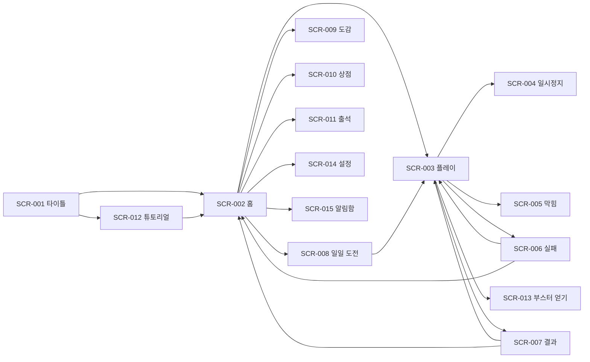

# UI UX 명세

- 문서 상태: approved
- 승인 근거: 사용자 질문 응답 2026-11-21 (DEC-013 시각 방향 B 캔디 팝). 이 문서는 고른 방향 안에서 화면과 상태를 파생한 것이다
- Source of truth: 화면 계약, 배치 수치, 상태, 피드백, 접근성, 첫 세션 스토리보드
- 기준 그림: `docs/game-design/ui/direction/`(플레이와 타이틀, 한국어와 영어)

모든 수치는 논리 화면 폭 390 기준의 px다. 화면은 폭 기준으로 늘어나고 높이만 달라진다.

## 내비게이션 그래프

뒤로 가기는 팝업, 하위 화면, 홈 순서로 닫는다. 홈에서는 한 번 더 누르면 종료한다는 안내를 띄운다. 플레이 중 뒤로 가기는 일시정지를 연다.

## 디자인 시스템

| 요소 | 값 |
|---|---|
| 배경 | 세로 그라데이션 `#58C4FF` → `#6E8CFF`(46%) → `#A56BFF`. 흰색 원 4개(불투명도 13~22%)가 천천히 떠다닌다 |
| 글자색 | 카드와 흰 판 위 `#3A3470`, 배경 위 흰색 |
| 강조색 | 주 버튼 주황(`#FFD23F` → `#FF8A00`), 선택 노랑 `#FFC61A`, 확인 초록 `#48D46A`, 완성 산호 `#FF6A5C`, 경고 빨강 `#FF4B5C` |
| 서체 | 제목·버튼·숫자 강조는 Fredoka(영문)와 Jua(한글), 본문은 Noto Sans KR, 지원코드와 긴 숫자는 Noto Sans Mono |
| 글자 크기 | 화면 제목 34, 팝업 제목 24, 버튼 22, 본문 16, 보조 14, 카드 이름 13.5~14.5, 배지 12. 큰 글자 설정은 공통 기반의 배율을 따른다 |
| 모서리 | 카드와 칸 16, 받침 22, 버튼 21~24, 팝업 30 |
| 깊이 | 그림자 대신 아래쪽 옆면(카드 6, 주 버튼 7, 보조 버튼 6)으로 두께를 보인다 |
| 누르는 영역 | 최소 48×48. 카드는 전체가 버튼이다 |
| 스킨 | `godot/game/skins/candy_pop/`의 8장과 `skin.json`. 플레이 전용 그림은 `godot/game/features/play/assets/`. 모두 `tools/art/build_candy_pop.py`가 만든다 |

구성요소와 상태:

| 구성요소 | 상태 |
|---|---|
| 카드 | 기본, 눌림(1.06배 뒤 복귀), 선택(노란 테, 7 들림, 체크 배지), 힌트(하늘색 테와 맥동), 흔들림(오답, 5번째 선택), 뒤집힘(뒷면), 이동 중 |
| 칸(임시 칸, 예비 자리) | 빈 칸, 놓을 수 있음(초록 점선과 맥동), 잠김(금색 테, 자물쇠, 광고 꼬리표 또는 코인 가격), 카드 있음 |
| 주 버튼 | 기본, 눌림(4 내려감), 비활성(회색) |
| 보조 버튼 | 기본, 눌림 |
| 부스터 버튼 | 기본(개수 배지), 0개(배지 대신 더하기 표시), 쓸 수 없음(회색, 일일 도전), 강조(맥동) |
| 메달(완성 묶음) | 빈 원(물음표), 완성(흰 원에 아이콘 4개와 이름표) |
| 코인 칩 | 기본, 증가 중(숫자가 올라가고 코인이 날아듦) |
| 하트(실수) | 남음, 잃음(회색), 방금 잃음(깨지는 연출) |
| 토스트 | 정보, "한 장만 달라요"(노랑), 경고(빨강) |

## 화면 계약

### SCR-001 타이틀

| 항목 | 내용 |
|---|---|
| 목적 | 제품을 알리고 실제 준비가 끝나면 시작하게 한다 |
| 진입·이탈 | 앱 실행 → 홈 또는 튜토리얼. 앱 복귀 때는 다시 보이지 않는다 |
| 시선 순서 | 로고 → 부채꼴 카드 네 장과 범주 이름표 → 진행 표시 → 시작 버튼 |
| 구역 | 위 110부터 로고(끼리끼리 62 또는 Four Alike 58, 흰색, 아래로 5 어긋난 남보라 그림자)와 부제. 가운데 카드 네 장(바나나, 레몬, 포도, 딸기)과 뒷면 두 장, 산호색 이름표. 아래 폭 250의 진행 막대, 상태 문구, 주 버튼, 버전과 제작사 |
| 주 행동 | 시작하기 |
| 상태 | 준비 중(막대가 실제 완료 단계만큼 참, 단계 이름 표시, 버튼 숨김), 준비 완료(막대 가득, 버튼 표시), 오류(문구와 다시 시도), 동의 필요(동의 창이 먼저 뜸) |
| 문구 | 부제 `연상 카드 퍼즐` / `Hidden Category Cards`, 버튼 `시작하기` / `Play`, 상태 `저장 불러오는 중`, `카드 준비 중`, `준비 완료` |
| 분석 | `app_open`, `title_ready`(준비에 걸린 ms) |
| 모션 | 로고가 위에서 내려와 한 번 튀고, 카드 네 장이 차례로 펼쳐진다. 배경 원은 느리게 떠다닌다. 움직임 줄이기에서는 정지 |

### SCR-002 홈

| 항목 | 내용 |
|---|---|
| 목적 | 다음 판을 바로 시작하게 하고 오늘 할 일을 보여 준다 |
| 시선 순서 | 스테이지 카드와 시작 버튼 → 일일 도전 카드 → 아래 진입 버튼 → 위쪽 코인 |
| 구역 | 위: 코인 칩(오른쪽), 설정과 알림함(왼쪽). 가운데: 스테이지 카드(스테이지 번호 34, 등급 이름, 모은 별 수, 다음 판의 뒷면 카드 네 장 그림)와 폭 250의 주 버튼. 그 아래: 일일 도전 카드(오늘 날짜, 상태, 연속 기록). 아래 한 줄: 도감, 상점, 출석의 원형 버튼 세 개와 이름 |
| 주 행동 | `스테이지 12 시작` / `Play Stage 12`. 진행 중인 판이 있으면 `이어 하기` / `Continue` |
| 상태 | 일일 도전 미완료(빨간 점 배지), 완료(초록 체크와 결과), 출석 받을 것 있음(배지), 알림 있음(배지), 진행 중인 판 있음 |
| 분석 | `screen_view`(home) |
| 모션 | 받을 것이 있는 버튼은 2초 주기로 살짝 커졌다 돌아온다 |

### SCR-003 플레이

기준 그림 `b-play-ko.png`가 이 화면의 목표다.

| 항목 | 내용 |
|---|---|
| 목적 | 카드를 살피고 묶고 옮긴다 |
| 시선 순서 | 더미의 열린 카드 → 받침의 임시 칸과 예비 카드 → 묶기 버튼 → 위쪽 메달과 하트 |
| 구역(위에서 아래) | 상단 줄 44: 일시정지(40), 스테이지 표지, 하트 4개, 코인 칩. 메달 줄: 원 58과 이름표, 범주 수만큼. 더미: 4열, 간격 8, 카드 폭 84.5. 뒤집힌 카드는 장당 22씩 위로 어긋나 보인다. 받침(둥근 반투명 판, 안쪽 여백 9): 임시 칸 줄(3칸, 가운데 정렬)과 예비 카드 줄(4칸씩 한 줄 또는 두 줄). 맨 아래: 힌트(52 원), 묶기(높이 58), 되돌리기(52 원) |
| 카드 높이 | 남는 높이를 줄 수로 나눠 84~122 사이에서 정한다. 예비 카드가 두 줄인 배치와 작은 화면에서는 낮아진다. 아이콘은 카드 높이의 44%(최소 38, 최대 54), 이름은 한 줄 우선이고 영어 긴 이름은 두 줄까지 |
| 주 행동 | 묶기. 4장을 골랐을 때만 활성. 버튼 안 오른쪽에 `2/4`처럼 고른 수를 보인다 |
| 보조 행동 | 카드 선택, 임시 칸으로 옮기기(카드 하나를 고른 뒤 빈 칸을 누르거나 끌어다 놓기), 힌트, 되돌리기, 잠긴 칸 열기, 일시정지 |
| 상태 | 선택 0~4, 임시 칸 0~3과 3번째 칸 잠김·열림, 실수 0~3, 막힌 길 안내 표시, 해결 연출 중(입력 잠금), 일일 도전(부스터 회색, 잠긴 칸 대신 빈 자리 없음 표시) |
| 문구 | `묶기` / `Group`, `힌트` / `Hint`, `되돌리기` / `Undo`, `임시 칸` / `Holding`, `예비 카드` / `Reserve`, `+1칸` / `+1 slot`, `광고` / `AD`, 토스트 `한 장만 달라요!` / `One away!`, `이미 해 본 조합이에요` / `Already tried`, `이대로는 풀 수 없어요` / `No way through from here` |
| 분석 | `level_start`, `group_complete`, `mistake`(one_away 여부), `hold_move`, `booster_used`, `stuck_shown`, `dead_end_shown`, `level_end` |
| 접근성 | 선택은 들림과 테두리와 체크로 구분한다. 완성 순서는 메달 위치로 보인다. 모든 카드에 이름이 있다 |

### SCR-004 일시정지

팝업. 제목 `잠깐 멈춤` / `Paused`. 버튼은 `계속` / `Resume`(주), `다시 하기` / `Restart`, `홈으로` / `Home`. 효과음과 음악 토글. 다시 하기와 홈으로는 진행을 잃는다는 한 줄 안내 뒤에 실행한다. 일일 도전에서는 다시 하기가 같은 판을 처음부터 다시 한다.

### SCR-005 막힘

팝업. 제목 `칸이 가득 찼어요` / `No room left`. 그림은 가득 찬 임시 칸. 버튼은 가능한 것만 보인다: `되돌리기`(보유 수 또는 코인 80), `칸 하나 더`(광고 꼬리표 또는 코인 150 또는 보유 수), `다시 하기`. 광고 버튼에는 무엇을 얻는지 적는다(`광고 보고 칸 하나 더` / `Watch ad for +1 slot`). 닫기를 누르면 판으로 돌아가 살펴볼 수 있고, 둘 수 없는 상태면 받침이 맥동한다.

### SCR-006 실패

팝업. 제목 `실수 4번` / `Out of mistakes`. 판 위에 남은 묶음의 정답과 범주 이름을 펼쳐 보인다. 버튼: `광고 보고 이어 하기 (실수 2번 지움)` / `Watch ad to continue (clears 2)`(판당 1회, 일일 도전 제외), `다시 하기`, `홈으로`. 세 버튼의 크기는 같다. 광고를 쓸 수 없을 때는 그 자리에 `코인 150으로 이어 하기` / `Continue for 150 coins` 버튼을 둔다(DEC-022). 효과와 판당 1회 제한은 광고 이어하기와 같다.

이어하기 버튼은 `FaContinueRound.check`의 결과로 정한다: `way`가 `ad`면 광고 버튼, `coins`면 코인 버튼, 광고도 못 쓰고 코인도 모자라면(`reason`이 `no_coins`) 코인 버튼을 가격이 빨간 비활성 모양으로 보이고 누르면 모자란 코인 수를 토스트로 알린다(상점의 코인 부족 표시와 같은 방식). 이미 이어 간 판과 일일 도전에서는 이어하기 버튼이 없다. 이어 갈 수 없을 때는 다시 하기가 주 버튼이다. 남은 묶음의 정답은 창 안에 범주 이름표와 카드 네 장의 줄로 펼친다.

### SCR-007 결과

| 항목 | 내용 |
|---|---|
| 목적 | 성과를 축하하고 다음 판으로 잇는다 |
| 시선 순서 | 별 → 코인 → 새로 모은 범주 → 다음 버튼 |
| 구역 | 제목 `클리어!` / `Cleared!`, 별 3개(얻은 만큼 채움), 코인 줄(이번 판 +N), 도감 새 범주 칩(있을 때), 버튼 줄 |
| 주 행동 | `다음` / `Next` |
| 보조 행동 | `광고 보고 코인 2배` / `Watch ad to double`(가능할 때만, 주 버튼과 같은 크기), `홈으로` |
| 상태 | 광고 가능, 광고 없음이나 상한 도달(2배 버튼 숨김), 2배 받음(코인이 한 번 더 올라가고 버튼 사라짐), 일일 도전(연속 기록과 공유 버튼, 다음 대신 `확인`) |
| 모션 | 별이 하나씩 튀어나오고(0.25초 간격) 코인 숫자가 올라가며 코인이 칩으로 날아간다 |
| 분석 | `level_end`(별, 실수, 임시 칸 사용, 걸린 초), `earn_virtual_currency` |

### SCR-008 일일 도전

화면. 위에 이번 달 달력(날짜 칸에 성공은 초록 체크, 실패 뒤 미완료는 빈 원, 오늘은 노란 테), 연속 기록 숫자, 오늘의 판 카드와 주 버튼 `오늘의 도전` / `Play Today`. 완료한 날은 결과(실수 수, 임시 칸 사용, 걸린 시간, 완성 순서)를 보여 주고 `결과 복사` / `Copy result` 버튼을 둔다. 지난 날짜를 누르면 그날의 판을 다시 풀 수 있다(연속 기록에는 넣지 않는다고 적는다). 규칙 안내 한 줄: `부스터 없이 풉니다` / `No boosters`.

### SCR-009 도감

화면. 위에 모은 범주 수와 전체 수, 다음 달성 보상까지 남은 수. 대분류별 묶음 아래 범주 칸이 4열로 놓인다. 모은 범주는 대표 아이콘과 이름, 못 모은 범주는 물음표 칸이다. 범주를 누르면 본 카드가 채워진 상세가 열린다(못 본 카드는 윤곽만). 목록은 카드 위를 밀어도 스크롤된다.

### SCR-010 상점

화면. 탭 둘: `부스터`와 `꾸미기`. 부스터는 힌트 100, 되돌리기 80, 칸 추가 150 코인이고 보유 수를 보인다. 꾸미기는 카드 뒷면 4종과 배경 4종이며 가진 것은 `사용` 버튼, 쓰는 중인 것은 체크다. 코인이 모자라면 가격이 빨갛게 보이고 누르면 모자란 수를 알려 준다. 결제 화면은 없다.

### SCR-011 출석

팝업. 7칸에 날짜별 보상이 보이고 오늘 칸이 강조된다. 주 버튼 `받기` / `Claim`. 받은 칸은 체크. 하루를 건너뛰면 1일째로 돌아간다는 안내는 넣지 않고 이어서 받는다(주기는 받은 횟수로 센다).

### SCR-012 튜토리얼

플레이 화면 위의 안내 층. 강조할 카드나 칸만 밝게 남기고 나머지를 어둡게 한다. 손가락 그림이 누를 곳을 가리키고 한 줄 말풍선이 뜬다. 단계: `같은 종류 네 장을 골라요` / `Pick four of a kind`, `맨 앞 카드를 임시 칸으로 옮겨요` / `Move the front card to a holding slot`, `남은 네 장을 묶어 보세요` / `Group the last four`. 끝나면 실수와 "한 장만 달라요"를 그림 한 장으로 보여 주고 시작 선물을 준다. 건너뛰기는 없다(한 판 2분 이내).

### SCR-013 부스터 얻기

팝업. 부스터가 0개일 때 버튼을 누르면 뜬다. 제목은 부스터 이름. 버튼 두 개를 같은 크기로 둔다: `코인 100` 과 `광고 보고 1개 받기` / `Watch ad for 1`. 광고가 없으면 광고 버튼 자리에 사유(`지금은 광고가 없어요` / `No ad available right now`)를 보인다. 닫기 가능.

### SCR-014 설정

공통 기반의 설정 화면을 쓴다. 언어, 효과음과 음악, 진동, 큰 글자, 움직임 줄이기, 분석 끄기, 지원코드, 개인정보처리방침, 개인정보 선택(동의 지역에서만), 오픈소스 고지(Fluent Emoji MIT, 글꼴 OFL, 광고 플러그인), 데이터 초기화(두 번 확인).

### SCR-015 알림함

공통 기반의 알림함을 쓴다. 첫 실행 환영 글과 운영 공지, 보상 수령이 들어온다.

## 상태 매트릭스

| 화면 | 기본 | 비어 있음 | 불러오는 중 | 오류 | 오프라인 | 완료 |
|---|---|---|---|---|---|---|
| 타이틀 | 준비 완료 | 해당 없음 | 단계별 진행 | 다시 시도 | 그대로 시작 가능 | 홈으로 |
| 홈 | 다음 스테이지 | 첫 실행은 튜토리얼로 | 해당 없음 | 저장 복구 안내 | 그대로 | 해당 없음 |
| 플레이 | 진행 중 | 해당 없음 | 배치 연출 | 판 자료 오류 시 홈으로 돌아가 알림 | 광고 버튼만 사유 표시 | 결과로 |
| 결과 | 별과 코인 | 해당 없음 | 광고 불러오는 중에는 2배 버튼에 점 세 개가 돈다 | 광고 실패 시 버튼을 숨기고 안내 | 2배 버튼 숨김 | 다음 판 |
| 일일 도전 | 오늘 미완료 | 지난 기록 없음 안내 | 해당 없음 | 팩에 없는 날짜는 순환 | 그대로 | 결과와 공유 |
| 도감 | 일부 모음 | `아직 모은 범주가 없어요` 와 시작 버튼 | 해당 없음 | 해당 없음 | 그대로 | 전부 모음 축하 |
| 상점 | 살 수 있음 | 해당 없음 | 해당 없음 | 코인 부족 안내 | 그대로 | 보유와 사용 중 |

## 피드백과 게임 필

| 행동 | 화면 | 소리 | 진동 |
|---|---|---|---|
| 카드 선택 | 1.06배로 튄 뒤 7 들림, 노란 테, 체크가 튀어나옴(100ms) | `card_select` | 약하게 |
| 선택 해제 | 내려앉음(80ms) | `card_deselect` | 없음 |
| 5번째 선택, 옮길 수 없는 카드 | 좌우 4 흔들림 3회(180ms) | 공통 `error` | 약하게 |
| 임시 칸으로 옮기기 | 카드가 호를 그리며 180ms에 이동, 칸이 한 번 눌림. 이어서 뒤 카드가 160ms에 뒤집힘 | `card_slide`, `card_flip` | 약하게 |
| 묶음 완성 | 4장이 40ms 간격으로 메달로 날아가고(320ms) 메달이 튀어나오며 터지는 입자, 이름표가 내려옴. 드러난 카드가 뒤집힘 | `group_complete` | 중간 |
| 오답 | 고른 카드가 흔들리고 하트 하나가 깨져 회색이 됨, 토스트 | `miss` 또는 `one_away` | 두 번 |
| 막힌 길 | 토스트, 되돌리기와 칸 추가가 맥동 | `stuck` | 없음 |
| 부스터 사용 | 버튼이 튀고 대상(카드 2장, 돌아가는 카드, 열리는 칸)에 반짝임 | `hint`, `undo`, `slot_unlock` | 약하게 |
| 클리어 | 색종이 입자, `클리어!` 글자가 튀어나옴 | `win` | 길게 한 번 |
| 결과의 별 | 하나씩 튀어나오며 반짝임 | `star_1`~`star_3` | 약하게 |
| 코인 획득 | 숫자가 600ms 동안 올라가고 코인이 칩으로 날아감 | `coin` 반복, 공통 `reward_sting` | 없음 |
| 버튼 | 눌림(4 내려감), 100ms 튐 | 공통 `tap`, `confirm`, `cancel` | 없음 |
| 팝업 | 220ms에 튀어나오고 140ms에 들어감, 뒤는 어둡게 | 공통 | 없음 |

같은 소리가 겹쳐 시끄럽지 않게 카드 선택음은 4번째까지 음높이를 한 단계씩 올린다. 움직임 줄이기를 켜면 이동은 즉시, 튀는 연출은 페이드로 바꾼다.

## 접근성

- 색에만 기대지 않는다: 선택은 들림·테두리·체크, 잠김은 자물쇠 그림, 완성은 위치와 이름표, 실수는 하트 수.
- 글자: 카드 이름 최소 12.5, 본문 16. 큰 글자 설정에서 카드 이름은 한 단계만 커지고 넘치면 두 줄로 나눈다.
- 대비: 흰 카드 위 `#3A3470` 글자는 대비 10:1 이상, 배경 위 흰 글자에는 남보라 그림자를 둔다.
- 누르는 영역 48 이상, 카드 사이 간격 8.
- 소리 없이도 모든 상태를 알 수 있고, 진동은 끌 수 있다.
- 시간 제한이 없다.

## 반응형 기기 매트릭스

| 이름 | 실제 비율 예 | 논리 크기 | 확인할 점 |
|---|---|---|---|
| 작은 화면 | 9:16 (360×640) | 390×693 | 예비 카드 두 줄 배치에서 카드 높이 84 이상, 묶기 버튼이 가려지지 않음 |
| 기준 | 9:19.5 (390×844) | 390×844 | 기준 그림과 같은 비례 |
| 긴 화면 | 9:20 (412×915) | 390×866 | 남는 높이는 더미와 받침 사이, 위아래 여백으로 나눔 |
| 아주 긴 화면 | 9:21 | 390×910 | 카드 높이 상한 122 유지 |

노치와 제스처 바는 기기의 안전 영역만큼 위아래 여백으로 뺀다. 상단 줄과 맨 아래 버튼 줄이 안전 영역을 침범하지 않아야 한다.

## 첫 세션 스토리보드

| 시간 | 화면 | 플레이어가 하는 일 | 느끼게 할 것 |
|---|---|---|---|
| 0:00 | 타이틀 | 로고와 카드 네 장을 보고 시작을 누른다 | 밝고 가벼운 카드 놀이 |
| 0:05 | 튜토리얼 1 | 강조된 과일 네 장을 누르고 묶는다 | 묶이는 순간의 시원함 |
| 0:25 | 튜토리얼 2 | 맨 앞 카드를 임시 칸으로 옮겨 숨은 카드를 열고 두 번째 묶음을 완성한다 | 가려진 카드를 여는 재미 |
| 0:50 | 튜토리얼 3 | 남은 네 장을 스스로 묶는다 | 혼자 해냈다는 느낌 |
| 1:10 | 안내 한 장과 선물 | 실수 규칙을 보고 코인과 부스터를 받는다 | 넉넉하게 시작한다는 느낌 |
| 1:25 | 홈 | 스테이지 1 시작을 누른다 | 다음 판이 바로 보임 |
| 1:30~4:30 | 스테이지 1~3 | 쉬운 판 세 개를 푼다. 3판에서 힌트를 한 번 써 본다 | 범주를 알아맞히는 눈이 생김 |
| 4:30 | 결과 | 별과 코인, 도감에 범주가 쌓이는 것을 본다 | 모으는 재미 |
| 5:00 | 홈 | 일일 도전과 출석이 열려 있음을 본다 | 내일 다시 올 이유 |

첫 세션에는 전면 광고가 없다.

## UI 인수 증거

| 증거 | 방법 | 통과 기준 |
|---|---|---|
| 필수 재료 게이트 | `ui_gate.py` 보고서 `docs/game-design/ui/gate-report.json` | 실패 항목 0 |
| 시안 대비 실행 화면 | 기준 그림과 같은 상태(스테이지 12, 날씨 완성, 과일 4장 선택, 임시 칸에 기타)를 렌더링해 나란히 비교 | 구도, 주 행동, 가독성의 차이를 기록하고 수정 결과를 남김 |
| 화면 크기 | 390×693, 390×844, 390×866에서 모든 화면 캡처 | 잘림과 겹침 없음, 카드 이름이 읽힘 |
| 언어 | 한국어와 영어로 모든 화면 캡처 | 넘침 없음. 가장 긴 카드 이름이 두 줄 안에 들어감 |
| 상태 | 카드와 버튼과 칸의 상태 시트 한 장 | 표의 모든 상태가 보임 |
| 연출 | 묶음 완성, 오답, 결과의 중간 프레임 캡처 | 표의 연출이 보임 |
| 독립 검수 | 구현자와 다른 에이전트의 3회 검수 보고서 | 마지막 회차의 기능과 UX 통과 |
