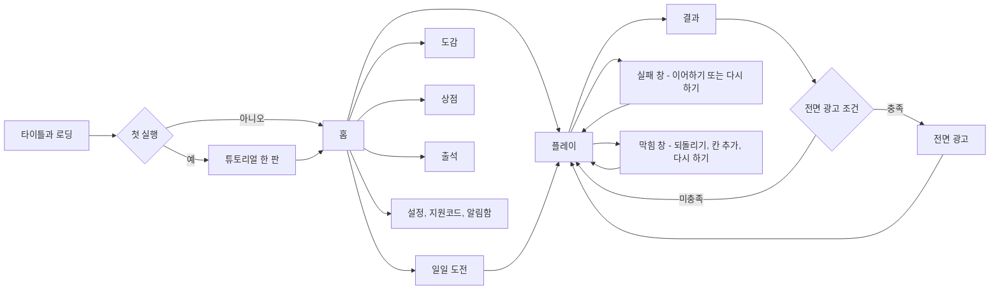
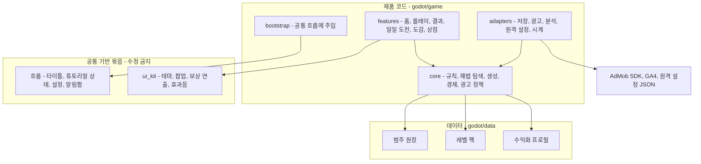

# 설계: Four Alike / 끼리끼리 첫 출시

- 설계 ID·버전·원본 커밋: `2026-11-21-four-alike-launch` v1. 저장소에 아직 커밋이 없어 원본 커밋은 승인 뒤 첫 설계 커밋으로 적는다
- 상태: 승인
- 승인자·시각·근거·승인 커밋: 사용자(제품 책임자), 2026-11-21, 대화의 질문 응답 세 차례([결정 로그](decision-log.md) DEC-001~004, DEC-013~016). 승인 커밋은 이 폴더를 처음 담은 설계 커밋이다
- 관련 Issue·PR·Wiki·검수: 승인 뒤 실행 티켓을 발행한다. Wiki가 없는 저장소이므로 `docs/design/README.md`에 목록을 둔다
- 검토용 화면 자료: `~/Pages/2026-11-21-four-alike-design/index.html` (시안 3안, 규칙 그림, 난이도 근거, 광고 시점)

이 문서는 승인 범위를 정하는 요약이다. 본문은 같은 폴더의 설계 팩에 있다.

| 문서 | 내용 | 상태 |
|---|---|---|
| [00 제품 브리프](00-product-brief.md) | 제품 계약, 타깃, 범위, 성공과 중단 기준 | 작성 |
| [01 리서치 조사서](01-research-dossier.md) | 경쟁작, 리뷰, 정책 원문, 라이선스, 제품명 | 작성 |
| [02 게임 디자인](02-gdd.md) | 규칙, 상태 머신, 진행, 저장, 인수 시나리오 | 작성 |
| [03 UI UX 명세](03-ui-ux-spec.md), [04 아트 오디오 바이블](04-art-audio-bible.md) | 화면 계약 15개, 스킨, 연출, 소리 | 작성(방향 B 캔디 팝) |
| [05 경제 콘텐츠 라이브옵스](05-economy-content-liveops.md) | 재화 수치, 콘텐츠 재고, 수익화 카탈로그, 원격 설정 | 작성(표는 수익화 프로필에서 생성) |
| [06 기술 제작 계획](06-technical-production-plan.md), [07 QA 론칭 계획](07-qa-launch-plan.md) | 구조, 데이터, 분석, 빌드, 검수, 출시 | 작성 |
| [결정 로그](decision-log.md) | 사용자 결정 4건과 제안 | 작성 |

## 목적·범위·근거

숨은 범주를 추리해 카드 4장을 묶고 임시 칸으로 뒤집힌 카드를 여는 연상 카드 퍼즐을 Godot 세로형 모바일 앱으로 만들어, 광고 수익으로 운영할 수 있는 상태까지 가져간다.

- 수요 근거: 단어 연상과 솔리테어를 합친 장르는 2025년 말부터 앱 마켓에서 크게 늘었다. 대표작 Solitaire Associations Journey는 Google Play 설치 1,000만 회 이상, 평점 4.4다(2026-11-21 스토어 표기). 유사작은 범주 카드 아래 단어를 쌓는 정렬 방식이 대부분이고, 숨은 범주와 가려진 더미와 임시 칸을 함께 쓰는 게임은 조사 범위에서 찾지 못했다([01](01-research-dossier.md)).
- 리뷰 근거: 경쟁작의 가장 잦은 불만은 광고 빈도와 판 도중 전면 광고다. 이 설계는 전면 광고를 판 종료 자리에만, 낮은 빈도로 둔다.
- 차별 근거: 이 게임은 범주 이름을 숨기고, 임시 칸 2개의 운영을 핵심으로 둔다. 사용자가 2026-11-20 웹 데모로 코어 루프를 확인했다.
- 난이도 근거: 규칙 프로토타입으로 배치별 무작위 판 4,000개를 풀었다. 기획서 표준 배치는 65.6%만 임시 칸 2개로 풀린다. 그래서 풀리는 판만 골라 싣고 "관대함" 지표로 등급을 나눈다([02](02-gdd.md) 진행 절).

| 포함 | 제외 |
|---|---|
| 판 진행 전체, 부스터 3종(힌트, 되돌리기, 칸 추가), 막힌 길 안내 | 인앱결제와 광고 제거 상품, 배너 광고 |
| 여정 스테이지 600개 검증 팩과 그 뒤 무한 생성, 5등급 난이도 | 범주 5개 판 |
| 일일 도전(연속 기록, 이번 달 달력, 결과 글자 공유) | 계정, 서버 순위표, 클라우드 저장, 푸시 알림 |
| 도감, 출석, 코인 상점(부스터, 카드 뒷면과 테이블 테마) | 웹 검색 유입 페이지와 웹 광고(앱 출시 뒤 별도 설계) |
| 보상형 4배치와 판 종료 전면, 동의 처리, 분석 이벤트, 원격 설정 | 영어와 한국어 밖의 언어 |
| 튜토리얼, 타이틀과 실제 로딩, 설정, 지원코드, 알림함, 저장과 이어하기 | 앱인토스용 웹 래퍼(마켓 선택에 따라 별도 진행) |
| 범주 150개 이상, 카드 700장 이상(영어·한국어), 효과음, 배경음악 1곡 | |

## 사용자 흐름·화면 상태

| 화면 | 주인공 | 가장 강조하는 행동 | 상태 |
|---|---|---|---|
| 타이틀 | 로고와 카드 네 장 | 시작 | 로딩 중, 준비 완료, 오류와 재시도 |
| 홈 | 다음 스테이지 | 스테이지 시작 | 일일 도전 미완료 배지, 출석 받을 것 있음, 알림 있음 |
| 플레이 | 카드 | 묶기 | 선택 0~4, 임시 칸 0~3, 실수 0~3, 막힌 길, 해결 연출 중 |
| 결과 | 별과 코인 | 다음 판 | 코인 2배 가능, 광고 없음, 도감 새 범주 |
| 실패 창 | 남은 판 | 이어하기 | 이어하기 가능, 이미 사용, 광고 없음 |
| 막힘 창 | 막힌 이유 | 칸 추가 | 되돌리기 가능 여부, 칸 추가 가능 여부, 코인 부족 |
| 일일 도전 | 오늘의 판 | 도전 | 미완료, 완료(결과와 공유), 지난 날짜 |
| 도감 | 모은 범주 | 둘러보기 | 비어 있음, 일부, 달성 보상 받을 것 있음 |
| 상점 | 부스터와 테마 | 구매 | 코인 부족, 보유 중, 적용 중 |

작은 화면(360×640), 기준(390×844), 긴 화면(9:21)에서 카드 글자가 잘리지 않아야 하고, 큰 글자 설정과 영어 긴 이름(두 줄까지)을 지원한다. 선택 상태는 색만이 아니라 카드가 들리고 체크 표시가 붙는 것으로 구분한다.

시각 방향은 같은 플레이 화면 시안 3안 가운데 사용자가 B 캔디 팝을 골랐다(DEC-013). 이 방향 안에서 나머지 화면과 버튼 상태, 연출을 만들고 실제 실행 화면과 시안을 비교해 맞춘다. 기준 그림은 `docs/game-design/ui/direction/`에 둔다.

## 구조·책임·의존성

공개 스타터 템플릿(`seorilabs/starter-template-game`, Godot 4.7.2)에서 저장소를 만들고 공통 기반 묶음을 그대로 쓴다. 공통 묶음의 세 폴더(`addons/seorilabs_game`, `addons/seorilabs_platform`, `tests/common`)는 고치지 않는다.

| 영역 | 템플릿이 주는 것 | 이 게임에서 만드는 것 |
|---|---|---|
| 화면 방향 | 가로 1280×720 고정 | 세로 390×844로 전환, 기능 목록의 가로 전용 항목 제거 |
| 타이틀, 설정, 지원코드, 알림함, 저장 틀 | 구현돼 있음. 문구와 색은 모험 게임 기본값 | 제품 타이틀과 홈과 결과 화면, 제품 스킨(`godot/game/skins/`), 제품 문구 |
| 튜토리얼 | 행동 3회 뒤 보상 1회라는 상태 틀 | 튜토리얼 판의 묶음 3개를 그 행동에 연결 |
| 광고 | 로그인과 서버 검증을 전제한 보상형만 | 광고 포트, 로컬 보상형과 전면 어댑터, 상한과 간격 판정, 동의(UMP), 설정의 개인정보 선택 진입점, 테스트 대역 |
| 분석, 원격 설정 | 로컬 모드에는 없음 | GA4 Measurement Protocol 어댑터(설정의 분석 끄기 반영), 저장소에서 배포하는 설정 JSON을 읽는 어댑터 |
| 결제, 로그인, 클라우드 저장 | 플러그인과 어댑터 포함 | 쓰지 않으므로 제품 쪽 어댑터와 플러그인을 걷어 낸다 |
| 검수 | 화면 입력 여정 드라이버, 구조 검사, 렌더 캡처 | 세로 기준 여정, 제품 기능 여정, 규칙·생성기·경제·광고 정책 프로브 |

`core`는 엔진 장면에 기대지 않는 순수 규칙이다. 해법 탐색기와 생성기는 GDScript 한 벌로 만들어 기기 안(막힌 길 판정, 601판 이후 생성)과 빌드 도구(팩 생성)에서 같이 쓴다. 팩의 정합성은 설계 단계에서 만든 Python 프로토타입 탐색기로 한 번 더 대조한다.

## 데이터·인터페이스·실패 처리

| 데이터 | 형식 | 만드는 곳 | 검증 |
|---|---|---|---|
| 범주 원장 | `items.json`(아이콘, 영어·한국어 이름, 태그), `categories.json`(이름, 대분류, 난도, 소속 항목, 헷갈릴 수 있는 항목) | 원본 표에서 도구로 생성 | 아이콘 존재, 이름 길이와 중복, 범주당 4장 이상, 언어별 독립 검수 기록 |
| 레벨 팩 | `journey.json` 600판, `daily.json` 1,100일. 판마다 배치, 카드 16장의 위치, 등급, 관대함 | 생성기를 headless로 실행 | 임시 칸 2개 해법 존재, 묶는 방법 유일, 다시 생성해도 같은 결과, Python 탐색기와 일치 |
| 수익화 프로필 | `bm-profile.json` (`ad-first-interstitial` 템플릿, 상품 없음) | 사내 프레임워크 도구 | 프레임워크 검사기와 수익 시뮬레이션 |
| 저장 | 공통 저장 파일과 별도의 제품 저장 파일 하나. 자체 버전 번호 | 기기 | 낮은 버전 올림, 높은 버전과 손상은 백업으로 복구([02](02-gdd.md) 저장 절) |
| 원격 설정 | 광고 배치별 켜기, 간격, 상한을 담은 JSON. 앱에는 같은 기본값 내장 | 저장소에서 정적 호스팅으로 배포 | 값 범위 검사, 받지 못하면 내장 기본값 |

| 실패 | 처리 |
|---|---|
| 광고를 불러오지 못함, 상한 도달 | 보상형 버튼은 사유를 보여 주고 코인 구매 길을 남긴다. 전면은 건너뛴다 |
| 보상형을 끝까지 보지 않음 | 보상 없음. 직후 전면 광고도 내지 않는다 |
| 원격 설정 수신 실패, 범위를 벗어난 값 | 내장 기본값 사용 |
| 분석 전송 실패 | 버린다. 게임 진행에 영향 없음 |
| 저장 파일 손상 | 백업에서 복구, 없으면 새로 시작하고 알린다 |
| 판 도중 종료 | 다음 실행에서 같은 상태로 복원 |
| 동의 창 거부 | 비개인화 광고로 요청하고 게임은 그대로 진행 |

## 품질 요구사항

| 항목 | 목표 | 측정 |
|---|---|---|
| 프레임 | 플레이 화면 60fps 유지, 연출 중 45fps 아래로 내려가지 않음 | 개발 환경 프로파일러, 승인된 기기 확인 |
| 시작 | 타이틀에서 시작 가능까지 3초 이내(중급 Android 기준) | 기기 확인 항목 |
| 용량 | AAB 60MB 이하 | 빌드 산출물 |
| 입력 | 카드와 버튼의 누르는 영역 48dp 이상, 탭 반응 100ms 이내 | 화면 프로브, 여정 |
| 접근성 | 색에만 기대지 않는 상태 표시, 큰 글자, 움직임 줄이기, 효과음과 음악 따로 끄기 | 검수 회차 |
| 개인정보 | 계정 없음. 수집은 광고 SDK와 분석 이벤트뿐. 13세 미만 대상 아님 | 마켓 신고 내용과 실제 동작 대조 |
| 광고 정책 | 전면은 판 종료 뒤에만, 닫을 수 있어야 함, 보상은 시청 완료 뒤에만 | 광고 정책 프로브, 기기 확인 |

## 대안·주요 결정

| 결정 | 선택 | 버린 대안과 이유 |
|---|---|---|
| 채널과 엔진 | Godot 모바일 앱(DEC-001) | 웹 우선: 사내에 웹 게임용 광고·검수·배포 틀이 없다 |
| 수익 | 보상형과 전면, 결제 없음(DEC-002) | 광고 제거 상품 동반: 사용자가 제외. 사내 규칙의 예외로 기록한다 |
| 카드 표현 | 단어와 Fluent Emoji Flat(DEC-003) | 자체 생성 아이콘: 비용과 검수 시간 |
| 레벨 공급 | 사전 생성 팩과 기기 생성 병행(DEC-007) | 기기 생성만: 일일 도전이 버전에 따라 달라지고 사전 검증을 보여 줄 수 없다 |
| 분석 | GA4 Measurement Protocol | Firebase 네이티브 SDK: 플러그인과 빌드 범위가 커진다. 분석 없음: 난이도와 광고 조정 근거가 없다 |
| 원격 설정 | 저장소에서 배포하는 JSON | Firebase Remote Config: 네이티브 SDK나 인증 절차가 필요하다 |
| 저장소 시작 | 스타터 템플릿과 공통 기반 | 빈 프로젝트: 타이틀, 설정, 검수 틀을 다시 만들게 된다 |

시각 방향, 출시 마켓과 끝 지점, 저장소 위치, 자원 생성과 기기 사용은 2026-11-21 응답으로 정해졌다(아래 승인 절).

## 인수조건·테스트·검수

규칙의 인수 시나리오 AC-001~018은 [02](02-gdd.md)에 있다. 출시 범위의 조건을 더한다.

| 조건 ID | 관찰할 동작·통과 기준 | 테스트 방법·환경 | 격리 데이터·시작 상태 | 기대 결과 | 증거 |
|---|---|---|---|---|---|
| AC-001~018 | 규칙, 부스터, 저장, 일일 도전, 튜토리얼, 광고 조건, 언어 | 규칙 프로브와 화면 입력 여정, 개발 환경 | 임시 저장 경로, 고정 시드와 시계, 광고 대역 | 02 문서의 통과 기준 | `journey.json`, 프로브 로그 |
| AC-101 | 첫 실행부터 튜토리얼, 스테이지 3판, 종료 뒤 재실행 복원까지 한 여정 | 화면 입력 여정, 3개 화면 크기 | 빈 저장 | 모든 단계 통과 | 여정 결과와 렌더 캡처 |
| AC-102 | 실은 팩의 모든 판이 2칸으로 풀리고 묶는 방법이 하나 | 생성 도구와 Python 대조 | 팩 파일 | 불일치 0 | 도구 출력 |
| AC-103 | 광고 대역으로 성공, 중도 닫기, 불러오기 실패, 상한 도달 | 여정과 광고 정책 프로브 | 고정 시계 | 보상 지급과 차단이 규칙대로 | 프로브 로그 |
| AC-104 | 필수 UI 재료 게이트 통과와 시안 대비 실행 화면 비교 | 게이트 도구, 렌더 캡처 비교 | 고른 시안 | 실패 항목 0, 차이 기록과 수정 | 게이트 보고서, 비교 캡처 |
| AC-105 | 수익화 프로필 검사와 시뮬레이션 | 사내 프레임워크 도구 | 프로필 | 오류 0, 필수 슬롯 경고는 승인된 예외 | 도구 출력 |
| AC-106 | Android 빌드가 설치되고 실제 광고 SDK가 동작 | 승인받은 실기기 항목 | 내부 테스트 설치본 | 아래 기기 확인 항목 통과 | 기기 확인 기록 |

- TDD 대상: `core`의 규칙, 해법 탐색, 생성기, 경제, 광고 정책, 저장 올림. 요구사항 때문에 실패하는 프로브를 먼저 쓰고 구현한다.
- TDD 적용이 어려운 부분: 스킨과 연출, 소리, 실제 광고 SDK 연결. 렌더 캡처 비교, 검수 회차, 기기 확인으로 대신한다.
- 테스트 계획: 같은 폴더의 [test-plan.json](test-plan.json).

| 항목 | 값 |
|---|---|
| 등급 | L3. 첫 출시라 전체 회귀다 |
| 실행 환경 | 개발 환경(화면 입력 여정과 렌더 캡처). Android 실기기는 아래 항목만 |
| 검증기 하한 | seoleeapps 저장소라 Seorilabs 중앙 검증기 대상이 아니다(princess-tycoon 선례). 계획 형식과 절차는 중앙 기준을 따른다 |
| 새 화면·UI 개편 | 예. 구현자와 다른 에이전트가 개발 환경에서 3회 검수한다 |
| 출시 마켓·끝 지점 | Google Play, 공개 출시까지(DEC-014) |

기기에서만 확인할 수 있는 항목은 다음과 같다. 사용자가 2026-11-21에 기기 사용을 승인했다(DEC-016). 구현자와 다른 에이전트가 Android 폰 1대에서 내부 테스트 설치본으로 약 30분 동안 이 항목만 확인한다. 이 앱만 설치하고 다른 앱과 데이터는 건드리지 않는다. 범위를 넘는 사용은 다시 승인받는다.

| ID | 항목 | 개발 환경으로 확인할 수 없는 이유 |
|---|---|---|
| AND-01 | 설치본 첫 실행과 렌더링, 시작 시간 | 기기 GPU와 Android 패키징 |
| AND-02 | 실제 터치로 선택, 끌어서 옮기기, 목록 스크롤 | 실제 터치 입력 |
| AND-03 | 강제 종료 뒤 판과 저장 복원 | Android 저장 경로와 프로세스 종료 |
| AND-04 | 뒤로 가기, 노치와 시스템 표시줄 | 시스템 입력과 화면 |
| AND-05 | 동의 창 표시와 선택 저장 | 실제 UMP SDK |
| AND-06 | 보상형 광고 불러오기, 시청 완료 보상, 중도 닫기 무보상 | 실제 AdMob SDK |
| AND-07 | 전면 광고 표시와 닫은 뒤 소리·입력 복귀, 광고 중 앱 전환 | 실제 AdMob SDK와 수명 주기 |
| AND-08 | 효과음, 배경음악, 진동 | 기기 출력 |

- 실행 못할 조건·필요한 승인·환경: 기기가 연결돼 있지 않으면 AND 항목은 미실행으로 남고, 광고 SDK의 실제 동작을 확인하지 못한 상태로는 공개 출시로 넘어가지 않는다.

## 적용·운영·되돌리기

1. 저장소를 스타터 템플릿에서 만들고 제품 식별자로 초기화한다. 세로 전환과 로컬 모드 정리로 기본 검사를 통과시킨다.
2. 규칙, 해법 탐색, 생성기를 프로브 먼저 구현하고 범주 원장과 레벨 팩을 만든다.
3. 고른 시각 방향으로 플레이 화면을 끝까지 구현해 시안과 비교한 뒤 나머지 화면으로 넓힌다.
4. 경제, 부스터, 일일 도전, 도감, 상점, 출석을 붙인다.
5. 광고 포트와 어댑터, 동의, 분석, 원격 설정을 붙인다.
6. 소리와 연출을 넣고 필수 재료 게이트와 3회 검수를 통과한다.
7. 빌드, 테스트 채널 업로드, 승인된 기기 항목 확인, 마켓 등록 자료와 문구 검수, 심사 제출, 공개 순으로 끝 지점까지 간다.

- 계측: 판 시작과 종료, 묶음 완성, 실수, 임시 칸 이동, 막힘, 부스터 사용, 코인 획득과 사용, 광고 요청·노출·실패·보상, 튜토리얼 시작과 완료, 일일 도전 완료. 이름은 GA4 권장 게임 이벤트를 먼저 쓴다.
- 되돌리기: 광고 문제는 원격 설정으로 배치를 끈다. 레벨이나 범주 문제는 해당 범주를 원장에서 내리고 팩을 다시 만들어 새 버전을 낸다. Google Play는 단계적 출시 비율로 확산을 멈출 수 있다.
- 남은 위험: 붐비는 장르, 범주 품질, 광고를 피할 수단이 없다는 점([00](00-product-brief.md) 주요 리스크).

## 승인·추적

사용자가 2026-11-21 대화의 질문 응답으로 아래를 정했다. 원문은 [결정 로그](decision-log.md)에 있다.

| 항목 | 결정 |
|---|---|
| 채널과 엔진, 수익, 카드 표현, 제품명 | Godot 모바일 앱, 보상형과 전면(결제 없음), 단어와 Fluent Emoji Flat, Four Alike / 끼리끼리 (DEC-001~004) |
| 시각 방향 | B 캔디 팝 (DEC-013) |
| 출시 마켓과 끝 지점 | Google Play, 공개 출시까지 (DEC-014) |
| 저장소와 식별자 | GitHub `seoleeapps/cluster-solitaire` 공개 저장소, 패키지 `com.seoleeapps.fouralike` (DEC-015) |
| 자원 생성 | AdMob 앱과 광고 단위, GA4 분석 속성, Google Play 앱 등록과 업로드 서명 키, 배경음악 생성 API (DEC-016) |
| 기기 사용 | Android 폰 1대, AND-01~08, 약 30분 (DEC-016) |

수익화 예외("전면 광고에 광고 제거 상품 없음")는 기획 원장 `seorilabs/planning`의 수익화 결정 로그에 새 항목으로 추가한다.

착수 뒤에는 중앙 개발 문서의 정지 조건에서만 멈춘다. 범위 안에서 고칠 수 없는 실패, 검사나 규칙에 의한 차단, 계획한 환경을 쓸 수 없는 경우, 범위 밖 수정을 요구하는 마켓 거절, 3회 검수 뒤 미해결, 승인 범위를 넘는 기기 사용이나 자원 생성이다.
