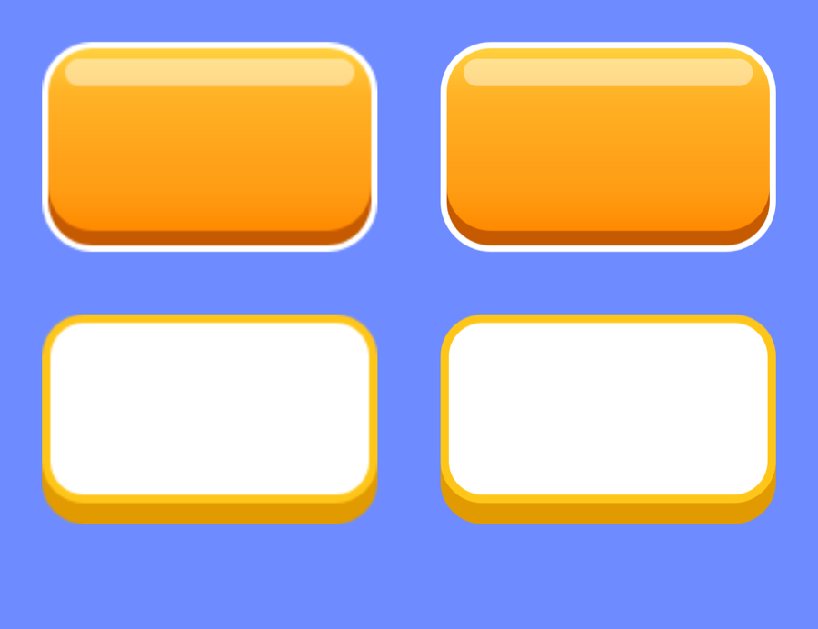

# 고해상도 화면의 벡터 그림

스킨과 플레이 그림은 SVG다. 프로젝트는 논리 폭 390에 `canvas_items` 늘림이라 휴대전화에서는 화면이 2.5~3배로 그려진다. SVG를 기본 설정으로 가져오면 1배 크기의 비트맵이 되어 확대되면서 가장자리가 흐려진다.

2026-11-21에 Godot 4.7.2에서 같은 그림 두 장(주 버튼, 선택된 카드 판)을 390×300 논리 화면, 1170×900 창으로 그려 비교했다. 왼쪽이 기본 가져오기(`CompressedTexture2D`), 오른쪽이 `DPITexture`다.

`DPITexture`는 화면 배율(뷰포트 오버샘플링, 이 실험에서 3.0)에 맞춰 SVG를 다시 그려 선명하고, 크기와 9분할 여백은 논리 단위 그대로다.

## 규칙

- 제품의 SVG 그림(스킨, 플레이 그림, 조작 아이콘)은 모두 `DPITexture.create_from_string(svg 원문, 1.0)`으로 만들어 쓴다. 도우미는 `godot/game/features/shared/fa_art.gd`이고 한 번 만든 텍스처는 경로별로 재사용한다.
- 공통 기반이 만든 테마의 `StyleBoxTexture`도 같은 SVG에서 만든 `DPITexture`로 바꿔 끼운다(`FaArt.sharpen`, bootstrap이 테마를 적용할 때마다 부른다).
- SVG 원문은 생성 도구(`tools/art/build_candy_pop.py`)가 만드는 묶음 `godot/game/features/shared/svg_sources.json`에서 읽는다. 열쇠는 `res://` 경로다. 개발 실행과 내보낸 앱이 같은 경로로 읽는다.
- 카드 그림(PNG 192px)은 38~54 논리 크기로 줄여 그리므로 3배 화면에서도 원본 해상도 안이다.

## 원문을 묶음으로 싣는 이유

처음에는 내보내기 설정의 포함 목록에 `*.svg`를 넣어 원본을 싣기로 했다. 2026-11-21에 Godot 4.7.2로 확인하니 그렇게 되지 않는다. 가져오기 설정이 있는 파일(SVG는 기본으로 텍스처로 가져온다)은 포함 목록에 적어도 가져온 결과(`.ctex`)와 `.import`만 묶음에 들어가고 원본 `.svg`는 빠진다. 반면 JSON은 설정 없이 파일 그대로 내보내진다.

| 확인 | 결과 |
|---|---|
| 작은 프로젝트에 SVG 두 장과 포함 목록 `art/*.svg`를 두고 `godot --headless --export-pack "Android" out.zip` | 묶음에 `art/*.svg.import`와 `.godot/imported/*.ctex`만 있고 `art/*.svg`는 없다 |
| 같은 프로젝트의 `data/x.json` | 포함 목록에 없어도 파일 그대로 들어간다 |

그래서 내보내기 설정을 고치지 않고 원문을 JSON 묶음 하나로 싣는다. 묶음은 생성물이라 `npm run check:generated`가 그림 폴더와 바이트까지 같은지 대조하고, `npm run check:export-pack`(`tools/check_export_pack.py`)이 실제로 Android 프리셋의 자료 묶음을 만들어 그 안에 묶음과 다른 원문 자료(콘텐츠, 레벨 팩, 수익화 프로필, 스킨 설정), 카드 그림, 소리가 들어 있는지 본다. 자료 묶음 만들기(`--export-pack`)는 내보내기 템플릿과 Android SDK 없이 돈다.

`.svg` 파일은 그대로 둔다. 생성 테마(`theme.tres`)와 공통 기반이 같은 경로의 가져온 텍스처를 참조하고, 실행 중에 같은 경로의 `DPITexture`로 바뀐다. 묶음에 없는 경로를 `FaArt.texture`에 넘기면 오류를 남기므로 여정과 프로브가 잡는다.

## 확인

- 3배 캡처: `godot --audio-driver Dummy --path godot --script res://tests/game/play_capture.gd -- --out <build 아래 폴더> --only reference`가 논리 390×844를 2배와 3배로 그린 PNG를 남긴다. 3배에서 카드 판, 버튼 테, 아이콘의 가장자리가 선명한지 본다.
- 기기에서의 선명도는 설계의 기기 확인 항목 AND-01(설치본 첫 실행과 렌더링)에서 본다. 개발 환경의 3배 캡처는 같은 그리기 경로(뷰포트 오버샘플링)를 쓰지만 기기 확인을 대신하지 않는다.
