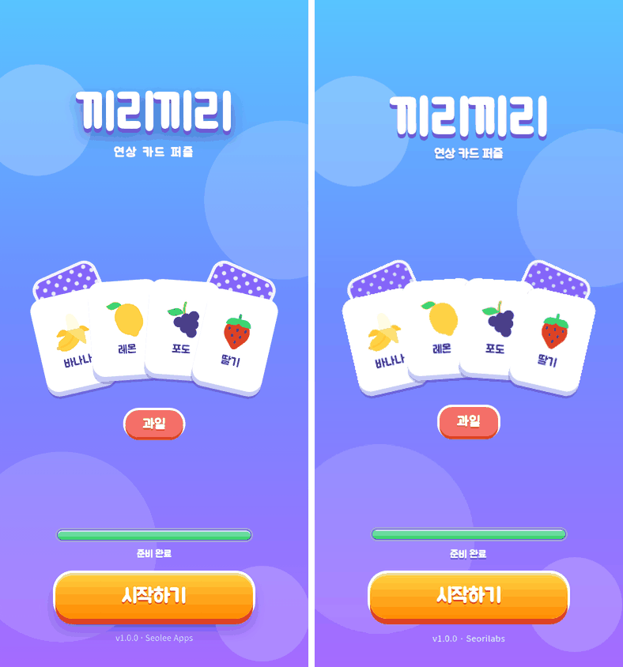
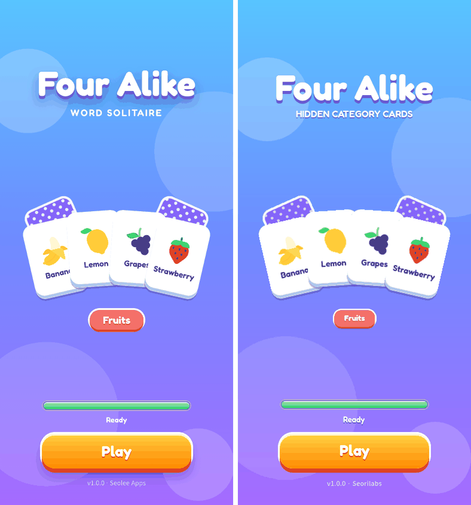
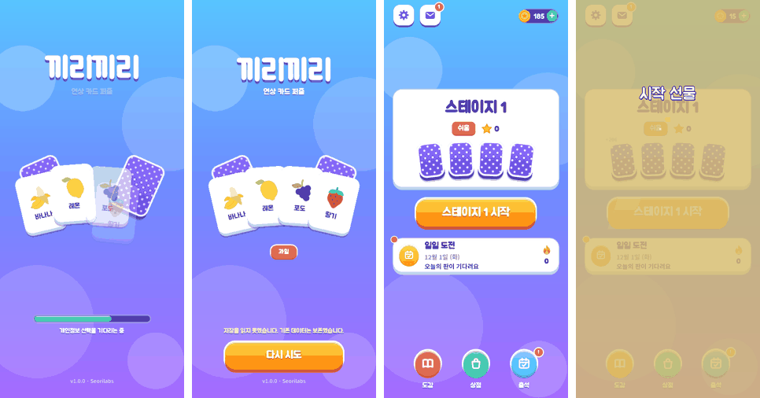
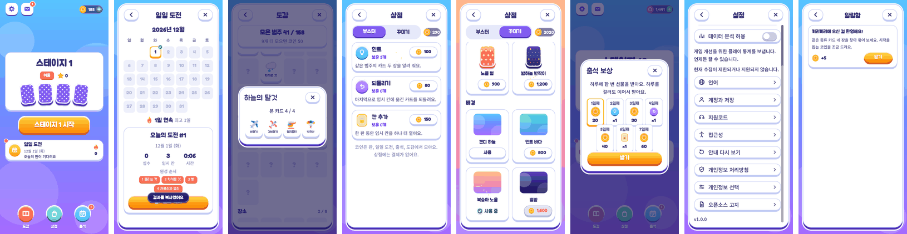
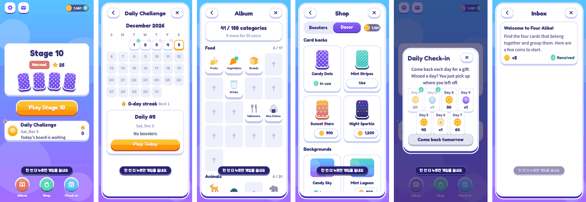
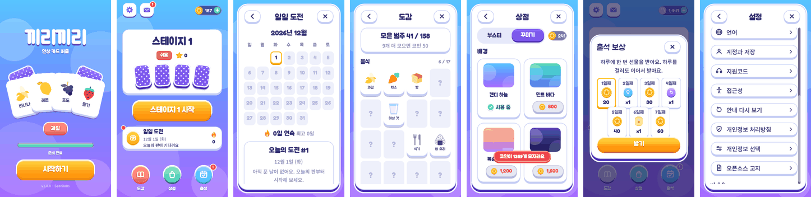

# 바깥 화면 비교 기록

- 대상: SCR-001 타이틀, SCR-002 홈, SCR-008 일일 도전, SCR-009 도감, SCR-010 상점, SCR-011 출석, SCR-014 설정, SCR-015 알림함. SCR-007 결과는 플레이 화면 작업의 것을 그대로 쓰고 도감과 맞는지만 봤다
- 기준 그림: 타이틀만 `docs/game-design/ui/direction/b-title-ko.png`, `b-title-en.png`(시안 B 캔디 팝 v1, DEC-013)이 있다. 다른 화면은 기준 그림이 없어 [UI UX 명세](../../design/2026-11-21-four-alike-launch/03-ui-ux-spec.md)의 화면 계약과 방향 규칙([direction/README.md](direction/README.md)), 플레이 화면의 구성요소를 기준으로 본다
- 구현: `godot/game/features/outgame/`, 공용 구성요소 `godot/game/features/shared/fa_ui.gd`, 그림 생성 `tools/art/build_candy_pop.py`
- 확인한 날: 2026-11-21, Godot 4.7.2, macOS(Apple M3), 렌더러 gl_compatibility
- 확인 방법: 개발 환경의 렌더링 실행(제품 여정의 캡처). 기기는 쓰지 않았다

## 캡처하는 법

```sh
python3 tools/check.py --capture --size 390x844 --out build/render-390
python3 tools/check.py --capture --size 360x640 --out build/render-360
```

여정이 화면 입력으로 진행하며 장면별 PNG를 남긴다. 바깥 화면의 PNG는 `title-consent`, `title`, `title-error`, `title-en`, `home`, `inbox`, `reward-impact`, `daily`, `daily-done`, `daily-past`, `album`, `album-detail`, `shop`, `shop-decor`, `shop-bought`, `home-decor`, `board-decor`, `attendance`, `attendance-reward`, `settings-privacy`, `licenses`와 영어·큰 글자의 `*-en`이다. 렌더링 실행은 프레임이 빨라서 안내 토스트(2초)가 다음 몇 화면의 캡처에도 남아 보인다. 실제 시간으로는 2초 뒤에 사라진다(따로 띄워 확인).

## 타이틀: 기준 그림과 실행 화면





| 요소 | 기준 그림 | 실행 화면 |
|---|---|---|
| 로고 | 위 110부터, 끼리끼리 62 / Four Alike 58, 흰색에 남보라 그림자 5 | 같음 |
| 부제 | 로고 아래 10, 16 | 같음. 영어는 03 문서의 문구 `Hidden Category Cards`를 시안처럼 대문자로 그린다 |
| 부채꼴 | 330×250 상자, 카드 90×120 네 장(기울기 -13, -4, 4, 13), 뒷면 86×116 두 장(±24), 산호색 이름표 | 같음. 실제 카드 구성요소(CardView)로 그린다 |
| 진행 막대 | 폭 250, 높이 18, 안쪽 3 | 같음. 채움은 실제로 끝난 준비 단계의 비율이다 |
| 시작 버튼 | 몸통 250×58, 흰 테 3, 옆면 7 | 같음(노드는 테와 옆면까지 256×68) |
| 버전과 제작사 | `v1.0.0 · Seolee Apps` | `v1.0.0 · Seorilabs`(공통 흐름의 `studio_name`, 아래 남은 차이 1) |

논리 픽셀로 잰 자리: 이름표 몸통 y 526~551(기준 522~552), 막대 채움 671~681(673~682), 시작 버튼 아래 끝 782(782), 로고 글자 아래 끝 189(189). 로고 글자의 위 끝은 121로 기준 그림(115)보다 6 아래다. 서체와 크기, 아래 끝은 같고 원인은 확인하지 못했다. 40 넘게 차이 나는 화소는 한국어 3.8%, 영어 4.7%(2배 그림 기준)이고 대부분 배경의 떠다니는 원과 글자 가장자리다. 이 수치는 변화를 재는 데만 쓴다.

## 상태

| 상태 | 화면 |
|---|---|
| 준비 중 | 막대가 끝난 단계만큼 차고 단계 이름(`저장 불러오는 중`, `카드 준비 중`)이 보이며 시작 버튼은 숨는다 |
| 동의 필요 | 동의 확인이 끝나지 않았으면 `개인정보 선택을 기다리는 중`과 함께 시작 버튼을 숨긴다. 규제 지역에서는 이때 UMP 양식이 먼저 뜬다. SDK가 답하지 않아도 5초 뒤에는 시작할 수 있다 |
| 준비 완료 | 막대가 가득 차고 `준비 완료`와 시작 버튼 |
| 오류 | 막대 대신 오류 문구와 `다시 시도` |
| 모션 | 로고가 위에서 내려와 한 번 튀고, 카드가 준비되면 네 장이 차례로 펼쳐진 뒤 이름표가 튀어나온다. 움직임 줄이기에서는 정지 |



## 다른 화면







| 화면 | 본 것 |
|---|---|
| 홈 | 위 줄(설정, 알림함과 배지, 코인 칩과 더하기), 스테이지 카드(번호 34, 등급 이름표, 별, 고른 카드 뒷면 네 장), 주 버튼(숨쉬기와 빛띠), 일일 도전 카드(날짜, 상태, 연속 기록, 빨간 점 또는 초록 체크), 둥근 버튼 세 개(받을 것이 있는 출석은 배지와 2초 맥동) |
| 일일 도전 | 이번 달 달력(성공 체크, 놓친 날 빈 원, 오늘 노란 테, 고른 날 보라 테, 앞날은 흐림), 연속 기록과 최고, 판 카드(규칙 `부스터 없이 풉니다`, 지난 날 안내, 결과와 완성 순서, 결과 복사) |
| 도감 | 모은 수와 다음 달성까지, 대분류별 4열 칸(모은 범주는 대표 카드와 이름, 못 모은 범주는 물음표), 상세(본 카드는 카드 판, 못 본 카드는 점선 윤곽) |
| 상점 | 탭 둘, 부스터 줄(그림, 이름, 보유 수, 가격 버튼, 설명), 꾸미기 카드(미리 보기, 이름, 사용 중 체크·사용 버튼·가격). 모자라면 가격이 빨갛다 |
| 출석 | 네 칸과 세 칸의 두 줄, 오늘 칸은 노란 테와 맥동, 받은 칸은 흐리게와 체크, 받은 날은 `내일 또 만나요` |
| 설정 | 그림과 꺾쇠가 있는 목록 줄, 제품 스위치, 개인정보처리방침, 개인정보 선택(필요할 때만), 오픈소스 고지 |
| 알림함 | 제품 문구의 환영 글, 코인 보상과 받기, 받은 뒤 체크 |

결과 창의 `도감에 새로 담았어요`에 나온 범주가 도감에서 모은 칸으로 보이는지 여정이 확인한다(`album`의 SCR-007 단계).

## 찾은 차이와 고친 것

| 차이 | 원인 | 고친 것 |
|---|---|---|
| 기울인 카드 뒷면(타이틀 부채꼴, 홈 스테이지 카드)의 물방울이 카드 밖에 흰 점으로 비어져 나옴 | 무늬를 사각 자르기(`clip_contents`)로 잘랐는데 이 자르기는 화면 축에 맞춘 사각형이라 기울기를 따르지 않음 | 기울여 그리는 카드는 둥근 판 모양 틀(`card_mask.svg`)로 무늬를 자른다(`CardView.clip_back_to_shape`) |
| 기울인 앞면 카드(타이틀 부채꼴)의 가장자리에도 흰 점이 보임 | 앞면 카드도 처음에는 뒷면 무늬 층이 켜진 채로 만들어지고, 판 화면과 달리 타이틀은 앞뒤를 따로 정하지 않음 | 카드를 만들 때 앞면 상태로 그린다(`CardView._init`의 `_refresh`) |
| 시작 버튼과 홈의 주 버튼이 기준 그림보다 낮고 막대가 9 위에 있음 | 노드 높이 65를 버튼 몸통으로 보고 배치함(그림은 테와 옆면까지 68) | 몸통 58로 자리를 잡고 노드는 테와 옆면만큼 크게 그린다(플레이 화면의 묶기 버튼과 같은 방식) |
| 범주 이름표가 기준 그림보다 얇음 | 몸통 31 | 시안의 위아래 여백 6에 맞춰 몸통 37로 그린다 |
| 저장을 읽지 못한 타이틀의 `다시 시도`가 엔진 기본 모양(짙은 회색)으로 그려짐 | 공통 흐름은 저장을 읽은 뒤에야 스킨 테마를 적용함 | 타이틀을 그릴 때 테마가 없으면 제품 스킨 테마를 먼저 적용한다(`_ensure_theme`) |
| 홈의 보상 연출 제목(`시작 선물`)이 스테이지 카드의 글자 위에 겹쳐 읽기 어렵고, 연출이 사라지는 중에 흐리게 남음 | 연출에 뒤 판이 없음. 캡처는 연출이 다 사라지기 전에 찍힘 | 연출 동안 뒤를 어둡게 깔고 끝나면 걷는다. 여정은 연출과 어두운 판이 사라진 뒤에 홈을 찍는다 |
| 한국어 안내가 `이/어서`, `두 장/을`처럼 낱말 가운데서 줄이 바뀜 | 줄바꿈 규칙(UAX #14)이 한글 음절 사이 어디서나 줄을 바꿀 수 있음. 엔진 설정(`ko@lw=keepall`)으로는 바뀌지 않음 | 한글이 낀 두 글자 사이에 폭 없는 낱말 이음표(U+2060)를 넣어 띄어쓰기에서만 바꾼다(`FaFonts.keep_words`). 글자 폭은 그대로다. 안내 글, 상점 설명, 알림함 본문, 설정의 안내 문장, 버튼의 두 줄 문구에 쓴다 |
| 일일 도전 결과의 `실수`, `임시 칸`, `시간`이 한 글자씩 세로로 쌓임 | 줄바꿈이 켜진 글이 폭 없는 칸에 들어감 | 칸 폭을 64로 두고 줄바꿈을 끈다 |
| 상점 꾸미기 탭의 `배경` 제목과 아래 안내 글이 보이지 않음 | 흰 판 위에 흰 글자 | 남보라와 흐린 남보라로 바꾼다 |
| 상점 부스터 설명이 좁은 칸에서 세 줄로 갈림 | 그림, 글, 가격 버튼이 한 줄에 있음 | 설명을 판의 폭 전체를 쓰는 아랫줄로 옮긴다 |
| 하위 화면 제목 `Daily Challenge`가 영어 큰 글자에서 두 줄이 되고 뒤로·닫기 버튼이 길게 늘어남 | 머리 줄의 제목 크기가 고정 | 뒤로와 닫기 사이에 들어갈 때까지 한 단계씩 줄이고(최소 17), 버튼은 세로 가운데에 둔다 |
| 홈의 일일 도전 카드 글이 큰 글자에서 판 아래로 넘침 | 카드 높이 고정 | 큰 글자에서는 높이를 9 늘린다 |
| 안내 토스트가 하위 화면의 머리 줄과 탭을 가림 | 화면 위쪽에 띄움 | 홈의 둥근 버튼 줄 바로 위(화면 아래에서 150)로 옮긴다 |
| 설정이 흰 알약 버튼을 쌓은 목록으로 보임 | 공통 화면의 버튼 그대로 | 줄마다 그림과 꺾쇠를 붙이고 글자를 왼쪽에 둔다. 토글은 제품 스위치 그림 |
| 오픈소스 고지 원문이 80자 줄바꿈 그대로라 들쭉날쭉함 | 원문의 줄바꿈 | 문단 안의 줄을 이어 그린다(글자는 그대로) |
| 큰 글자 설정이 바깥 화면의 글에 반영되지 않음 | 제품 화면의 글자 크기가 고정 | 공통 흐름과 같은 +3을 안내 글, 제목, 목록 글에 더한다(`FaUi.sized`) |
| 홈과 하위 화면을 오가면 공통 흐름의 초점 되돌리기가 오류를 냄 | 공통 코드가 그림 버튼(TextureButton)의 `text`를 읽음 | 제품의 `_restore_focus`가 이름 우선으로 같은 일을 한다(공통에서 고칠 것은 작업 보고에 적었다) |

## 남은 차이

| # | 차이 | 이유 |
|---|---|---|
| 1 | 제작사 표기가 기준 그림의 `Seolee Apps`가 아니라 `Seorilabs`다 | 지시대로 공통 기반의 표기(`studio_name`)를 그대로 둔다(DEC-023) |
| 2 | 영어 부제가 시안의 `WORD SOLITAIRE`가 아니라 `HIDDEN CATEGORY CARDS`다 | 03 문서의 문구를 따른다(DEC-024) |
| 3 | 타이틀 로고 글자의 위 끝이 기준 그림보다 6 아래다 | 같은 서체(Jua, 굵게 불림)와 크기 62이고 아래 끝은 같다. 원인은 확인하지 못했다(브라우저와 엔진의 획 불림 차이로 짐작) |
| 4 | 공통 화면(언어, 접근성, 지원코드, 계정과 저장)은 머리 줄과 스위치만 제품 모양이고 버튼은 공통 스킨의 보조 버튼이다 | 03 문서가 공통 기반의 화면을 쓰기로 했다 |
| 5 | 설정에 데이터 초기화(두 번 확인)가 없다 | 이 비교 뒤의 후속 작업에서 설정의 마지막 줄로 넣었다(여정 `data-reset`) |
| 6 | 배경의 흰 원이 캡처마다 몇 픽셀 다른 곳에 있다 | 원이 천천히 떠다닌다 |

## 확인한 크기와 언어

| 확인 | 결과 |
|---|---|
| 390×844, 360×640 렌더링 여정 | 두 크기 모두 21개 시나리오 통과. 타이틀, 홈, 하위 화면의 목록 밖 버튼이 화면 안에 있고 겹치지 않는다(여정의 fits 단계) |
| 한국어와 영어 | 한국어는 처음부터, 영어는 `outgame-english-large-text`와 `live-services-offline`에서 찍었다 |
| 큰 글자 | 설정에서 켠 뒤의 시나리오(일일 도전부터)는 모두 큰 글자다 |
| 3배 화면의 선명도 | 바깥 화면 그림도 플레이 그림과 같은 `DPITexture` 길로 그린다. 3배 캡처는 하지 않았고 기기의 선명도는 AND-01에서 본다 |

## 확인하지 못한 것

| 항목 | 이유 |
|---|---|
| 규제 지역의 실제 동의 양식, 광고 표시와 보상, 분석 수신 | 기기와 네이티브 SDK가 필요하다(AND-05~07). 개발 환경에서는 동의와 광고를 대역으로 확인했다 |
| 진동의 실제 느낌 | 기기가 필요하다(AND-08). 요청한 진동 길이는 여정이 센다 |
| 소리의 실제 청취 | 요청 횟수만 확인했다 |
