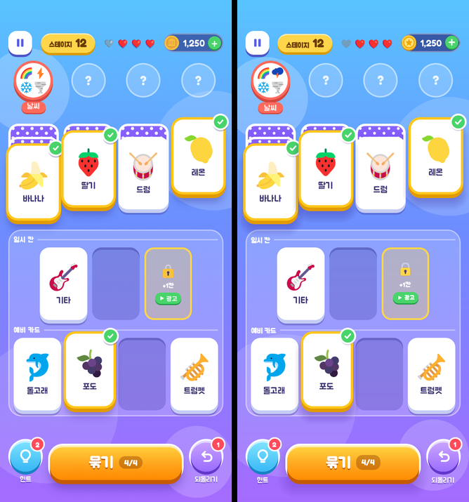
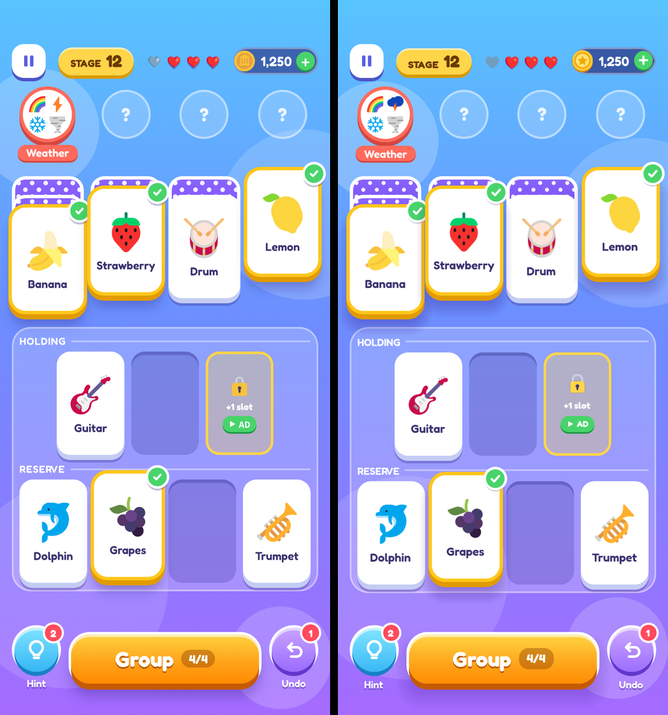
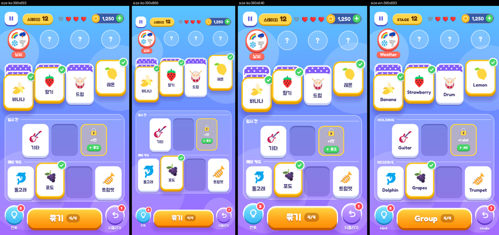
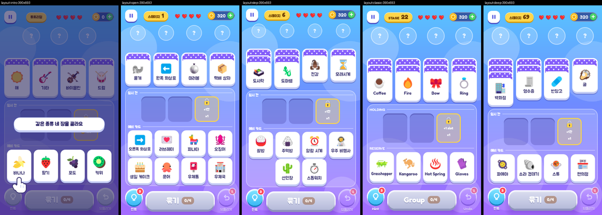
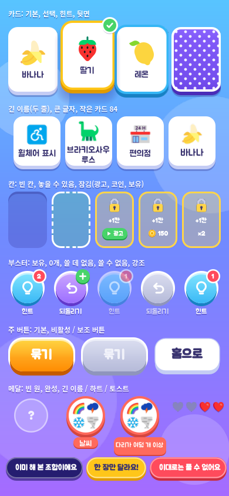
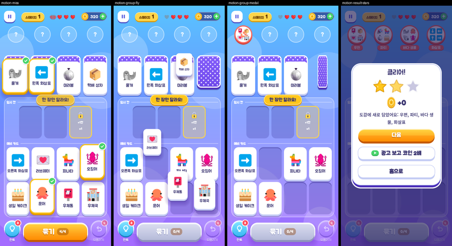
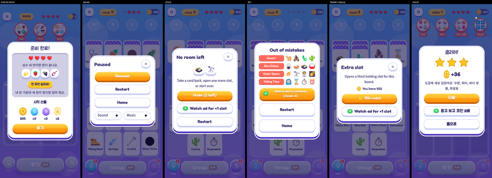

# 플레이 화면 비교 기록

- 대상: SCR-003 플레이와 딸린 팝업(SCR-004~007, SCR-012~013)
- 기준 그림: `docs/game-design/ui/direction/b-play-ko.png`, `b-play-en.png` (시안 B 캔디 팝 v1, 사용자 선택 2026-11-21, DEC-013). 390×844 논리 화면을 2배로 그린 것이다
- 구현: `godot/game/features/play/`, 스킨 `godot/game/skins/candy_pop/`, 그림 생성 `tools/art/build_candy_pop.py`
- 확인한 날: 2026-11-21, Godot 4.7.2, macOS(Apple M3), 렌더러 gl_compatibility
- 확인 방법: 개발 환경의 렌더링 실행. 기기는 쓰지 않았다

기준 그림과 같은 상태(스테이지 12, 날씨 완성, 과일 네 장 선택, 임시 칸에 기타, 3번째 칸 잠김, 실수 1, 코인 1,250, 힌트 2, 되돌리기 1)를 만들어 같은 배율로 찍고, 나란히 놓은 그림과 같은 줄의 색 구간을 재서 비교했다. 캡처 원본은 저장소에 넣지 않고 `build/` 아래에 둔다. 이 폴더의 `play/`에는 줄인 그림만 있다.

## 캡처하는 법

```sh
godot --audio-driver Dummy --path godot --script res://tests/game/play_capture.gd -- --out "$PWD/build/play-capture"
godot --audio-driver Dummy --path godot --script res://tests/game/play_capture.gd -- --out "$PWD/build/play-capture" --only reference
```

`--only`에는 `reference`(기준 그림과 같은 상태, 한국어와 영어, 1배·2배·3배), `sizes`(390×693, 390×844, 390×866, 360×640), `layouts`(다섯 배치를 세 크기에서), `states`(상태 시트), `motion`(연출의 중간 프레임), `daily`(일일 도전 모드)를 준다. 고정 자료는 네 가지다.

| 고정 자료 | 이유 |
|---|---|
| 저장 파일을 미리 만들어 기준 그림의 판에서 시작한다 | 기준 그림의 판은 손으로 만든 예시라 여정으로는 닿을 수 없다. 선택(과일 네 장)은 화면 입력으로 한다 |
| 안전 영역을 위 34, 아래 16으로 넣는다 | 기준 그림은 위 50, 아래 30의 여백으로 그려졌다. 화면의 기본 여백 16과 14에 노치와 제스처 바를 더한 값이다 |
| 빈 상점 경로를 등록한다 | 코인 칩의 더하기는 상점 화면이 있을 때만 보인다. 상점은 다음 작업이다 |
| 일일 도전은 시작 장면의 `launch_daily`를 직접 부른다 | 일일 도전에 들어가는 화면이 아직 없다. 판에 들어간 뒤의 조작은 화면 입력으로 한다 |

## 기준 그림과 실행 화면

| 한국어 | 영어 |
|---|---|
|  |  |

두 그림 모두 왼쪽이 기준 그림, 오른쪽이 실행 화면(2배 캡처)이다.

한국어 화면의 자리는 기준 그림에서 잰 값과 실행 화면에서 잰 값이 1 이내로 같다(논리 픽셀).

| 요소 | 기준 그림 | 실행 화면 |
|---|---|---|
| 상단 줄(일시정지 판) | y 52~92, 옆면 4 | 같음 |
| 스테이지 표지 | x 69.5~159.5, y 57~88, 옆면 4 | x 69~160, y 57.5~87.5 |
| 코인 칩 | x 276~376, y 56~88 | 같음 |
| 메달(완성) | 원 58, 테 4, 옆면 5, 이름표 y 172~190 | 같음 |
| 더미 | 맨 위 y 208, 뒤집힌 카드 22씩, 카드 84.5×122 | 같음 |
| 선택한 카드 | 테 4, 옆면 6, 7 들림 | 같음 |
| 받침 | y 386~700, 임시 칸 줄 y 416, 예비 카드 줄 y 568, 칸 80×122 | 같음 |
| 묶기 버튼 | x 84~306, y 749~807, 테 3, 옆면 7 | 같음 |
| 부스터 | 원 52(테 3), y 741부터, 옆면 5 | 같음 |

40 넘게 차이 나는 화소(2배 그림 기준)는 한국어 1.5%, 영어 3.0%다. 남은 곳은 글자와 아이콘의 가장자리, 아래 "남은 차이"의 항목이다. 이 수치는 변화를 재는 데만 쓰고 통과 기준으로 삼지 않는다.

## 항목별 판정

| 항목 | 본 것 | 판정 |
|---|---|---|
| 구도와 시선 | 더미의 열린 카드, 받침, 묶기 버튼, 위쪽 메달과 하트의 순서와 크기가 기준 그림과 같다 | 통과 |
| 주 행동 | 묶기 버튼이 화면에서 하나뿐인 주황 버튼이고 고른 수(`4/4`)가 버튼 안에 보인다. 4장을 고르기 전에는 회색이다 | 통과 |
| 가독성 | 카드 이름 한국어 15, 영어 14. 800장의 이름이 두 언어, 큰 글자 설정, 폭 80인 카드에서 두 줄 안에 들어간다(프로브) | 통과 |
| 색 | 배경 그라데이션, 카드와 옆면, 선택 노랑, 완성 산호, 버튼 주황, 칸과 받침의 색이 기준 그림의 값과 같다 | 통과 |
| 두께 | 카드 옆면 6과 그림자 3, 선택 테 4, 주 버튼 옆면 7과 흰 테 3, 부스터 옆면 5, 표지와 일시정지 옆면 4 | 통과 |
| 글자 크기 | 표지 12와 20, 줄 이름 12, 버튼 25, 개수 14, 배지 12, 부스터 이름 12 | 통과(아래 3번) |
| 상태 | 선택은 들림과 테와 체크, 잠김은 자물쇠와 금색 테, 놓을 수 있는 칸은 점선, 실수는 하트 수, 완성 순서는 메달 위치 | 통과 |
| 피드백 | 선택음의 음높이, 임시 칸 이동의 호, 뒤집힘, 메달로 날아감과 입자, 오답의 흔들림과 하트 깨짐, 색종이와 별 | 통과(소리는 요청 횟수만 확인, 청취는 사용자 확인 대기) |

## 찾은 차이와 고친 것

| 차이 | 원인 | 고친 것 |
|---|---|---|
| 카드의 아이콘이 12만큼 위에 놓이고 이름과 사이가 벌어짐 | 이름 Label의 높이를 줄이 정해지기 전의 값(두 줄)으로 읽음 | 이름 칸의 높이를 글자 크기의 1.1배로 직접 계산해 배치한다 |
| 선택한 카드의 옆면이 10 | 그림 생성 값이 시안과 다름 | 옆면 6으로 다시 만든다 |
| 굵은 제목 자리의 한글(스테이지, 임시 칸, 묶기, +1칸)이 가늘다 | 시안은 브라우저가 굵기 없는 Jua를 굵게 불려 그린다 | 같은 양(글자 크기의 1/24)으로 획을 불린다 |
| 하트가 크고 왼쪽으로 3 치우침, 잃은 하트가 밝다 | 그림 크기 22, 색 | 19로 줄이고 색과 그림자를 고친다 |
| 코인 칩의 높이가 30 | 판 그림의 빈 테두리 1을 계산에 넣지 않음 | 보이는 높이 32가 되게 놓는다 |
| 주 버튼의 흰 테가 옆면 아래까지 감싸고 위에 광택 막대가 떠 있음 | 그림이 시안과 다름 | 흰 테는 몸통만, 위쪽은 3 두께의 밝은 띠로 다시 만든다 |
| 부스터 원판의 흰 테가 옆면 아래까지 감쌈 | 위와 같음 | 시안처럼 옆면이 테 위로 나오게 다시 만든다 |
| 카드 뒷면을 늘려 그리면 물방울이 타원이 됨 | 한 장짜리 그림을 카드 높이에 맞춰 늘림 | 9분할 판과 물방울 층으로 나눈다 |
| 주 버튼 아래 그림자가 진함 | 겹친 사각형으로 만든 그림자의 가운데가 짙음 | 불투명도를 60%로 낮춘다 |
| 체크와 더하기의 획이 굵음 | 그림이 시안보다 큼 | 시안의 획 굵기로 다시 만든다 |
| 잠긴 칸의 자물쇠가 작고 2 아래에 있음 | 아이콘 크기와 줄 높이 | 28로 키우고 2 올린다 |
| 힌트가 맥동할 때 뒤의 카드가 비침 | 판의 불투명도를 바꿈 | 판의 크기만 5% 오가게 한다 |
| 묶음 완성 때 카드가 반대쪽으로 물러났다가 날아가 화면 밖으로 나감 | 뒤로 당겼다 가는 가속 곡선 | 가속만 하는 곡선으로 바꾼다 |
| 긴 영어 낱말 8개(Brachiosaurus, Thundercloud 등)가 카드 폭을 넘음 | 낱말 하나가 최소 글자로도 74를 넘음 | Fredoka의 폭 축을 90, 80, 75로 차례로 좁혀 넣는다 |
| 좁은 카드에서 한글 이름이 낱말 가운데서 끊김(오른쪽 화살/표) | 한글은 글자 사이 어디서나 줄이 바뀜 | 띄어쓰기에서 나눠 두 줄에 들어가면 그 자리에서 나눈다 |
| 토스트가 더미의 카드 이름을 가림 | 받침 위쪽 빈 자리가 깊은 더미에서는 없음 | 받침의 줄 이름 위에 놓는다 |
| 팝업의 광고·코인 버튼에서 아이콘이 왼쪽 끝에 떨어져 있음 | 버튼의 기본 아이콘 정렬 | 아이콘과 글자를 한 줄로 묶어 가운데에 둔다 |
| 이어 갈 길이 없는 실패 창(일일 도전, 코인 부족)에 주 버튼이 없음 | 다시 하기와 홈으로가 모두 보조 버튼 | 이어하기를 못 하면 다시 하기를 주 버튼으로 그린다 |
| 튜토리얼의 손가락이 카드 이름을, 말풍선이 더미의 카드를 가림 | 손끝과 말풍선의 자리 | 손끝은 대상의 아래쪽, 말풍선은 비어 있는 줄에 둔다 |
| 시작 선물 연출이 홈의 스테이지 번호와 겹침 | 연출의 중심이 화면 가운데 | 번호 위쪽 빈 자리로 올린다 |
| 화면 크기가 바뀌면 카드가 옛 자리와 크기로 남음 | 자리 계산이 칸과 버튼만 다시 놓음 | 두는 중이면 카드까지 새 크기로 다시 놓고 선택과 힌트 표시는 그대로 둔다 |

## 남은 차이

| # | 차이 | 이유 |
|---|---|---|
| 1 | 코인 아이콘이 시안(건물 무늬 동전)과 다른 별 동전이다 | 시안은 Fluent Emoji의 동전을 임시로 썼고, 아트 바이블은 스킨의 자체 코인 아이콘(`icon_coin.svg`)을 쓰기로 했다 |
| 2 | 날씨 메달의 둘째 아이콘이 번개가 아니라 번개 구름이다 | 최종 콘텐츠에서 날씨 범주의 카드가 바뀌었다 |
| 3 | 카드 이름이 한국어 15, 영어 14로 시안(14.5, 13.5)보다 0.5 크다 | 엔진의 글자 크기는 정수다. 읽기 쉬운 쪽으로 올렸다 |
| 4 | 하트와 자물쇠가 Fluent Emoji가 아니라 자체 그림이다 | 조작 아이콘은 자체 제작으로 정했다(아트 바이블). 크기와 색은 맞췄다 |
| 5 | 선택한 카드와 묶기 버튼 아래의 번진 그림자 모양이 조금 다르다 | 엔진의 SVG 판독기에 흐림 필터가 없어 반투명 사각형 14겹으로 만든다 |
| 6 | 코인 칩의 더하기는 상점 경로가 등록됐을 때만 보인다 | 누를 곳이 없는 버튼을 두지 않는다. 상점 화면을 붙이면 보인다 |
| 7 | 안전 영역이 없는 390×844에서는 위 여백이 50보다 작다 | 기준 그림의 50과 30은 노치와 제스처 바를 포함한 값이다. 남는 높이는 위 여백, 더미 아래, 버튼 위에 나눈다 |
| 8 | 영어 화면에서 받침 안의 두 줄이 기준 그림보다 1.5쯤 아래에 있다 | 시안은 줄 이름의 높이가 언어마다 달라 영어에서 줄이 조금 올라간다. 구현은 두 언어의 자리를 같게 둔다 |
| 9 | 배경의 흰 원이 캡처마다 몇 픽셀 다른 곳에 있다 | 원이 천천히 떠다닌다 |

구도, 주 행동, 가독성의 차이는 남지 않았다.

## 화면 크기와 배치



왼쪽부터 390×693, 390×866, 360×640(한국어), 390×693(영어). 안전 영역 없이 찍었다. 360×640은 지원 범위(논리 화면 390×693 이상)보다 작아 화면 전체를 0.97배로 줄여 그린다.



왼쪽부터 intro(튜토리얼 1단계), open, step, classic(영어), deep. 예비 카드가 두 줄인 open과 step에서 카드 높이는 84다.

| 확인 | 결과 |
|---|---|
| 390×693, 390×844, 390×866에서 다섯 배치 | 카드와 칸과 버튼이 화면 안에 있고 겹치지 않는다. 카드 높이 84 이상. 누르는 영역 48 이상(캡처 도구의 단계, 15개 조합 모두 통과) |
| 390×910과 안전 영역(위 34, 아래 16)을 넣은 경우 | `fa_play_layout_probe.gd`가 구역의 순서와 겹침, 카드 높이 84~122, 기준 그림의 자리를 계산으로 확인한다 |
| 여정 전체를 390×844, 390×693, 390×866, 360×640으로 렌더링 | `tools/check.py --capture` 네 크기 모두 통과 |
| 한국어와 영어 | 두 언어로 기준 상태, 네 크기, 팝업을 찍어 넘침이 없음을 봤다 |
| 3배 화면 | `reference-ko-3x.png`, `reference-en-3x.png`(1170×2532)에서 카드 판, 버튼 테, 아이콘, 글자의 가장자리가 선명하다 |
| 일일 도전 모드 | 임시 칸 2개에 잠긴 칸 없음, 부스터 회색, 표지에 날짜, 실패 창에 이어하기 없음 |

## 상태와 연출

| 상태 시트 | 연출의 중간 프레임 |
|---|---|
|  |  |

상태 시트는 카드(기본, 선택, 힌트, 뒷면, 긴 이름, 큰 글자), 칸(빈 칸, 놓을 수 있음, 잠김의 세 꼬리표), 부스터(보유, 0개, 쓸 데 없음, 쓸 수 없음, 강조), 주 버튼과 보조 버튼, 메달, 하트, 토스트 세 종류를 실제 구성요소로 그린 것이다. 연출 그림은 왼쪽부터 오답(흔들림, 하트 깨짐, 토스트), 묶음 완성(카드가 메달로 날아감), 메달이 튀어나오고 드러난 카드가 뒤집힘, 결과 창의 별이다.



왼쪽부터 튜토리얼 끝 카드, 일시정지, 막힘, 실패, 부스터 얻기, 결과.

## 확인하지 못한 것

| 항목 | 이유 |
|---|---|
| 실제 기기의 화면 배율과 안전 영역 | 기기를 쓰지 않았다. 안전 영역을 논리 픽셀로 바꾸는 계산은 프로브로만 확인했다. 설계의 기기 확인 항목 AND-01, AND-04에서 본다 |
| 실제 터치로 끌기 | 여정은 화면 좌표 입력으로 끌기를 확인한다. 실제 터치는 AND-02에서 본다 |
| 소리와 진동의 체감 | 요청 횟수만 확인했다. 청취는 사용자 확인 대기(아트 바이블), 기기 출력은 AND-08 |
| 독립 검수 3회 | 구현자와 다른 검수자의 검수는 이 기록에 들어 있지 않다 |
